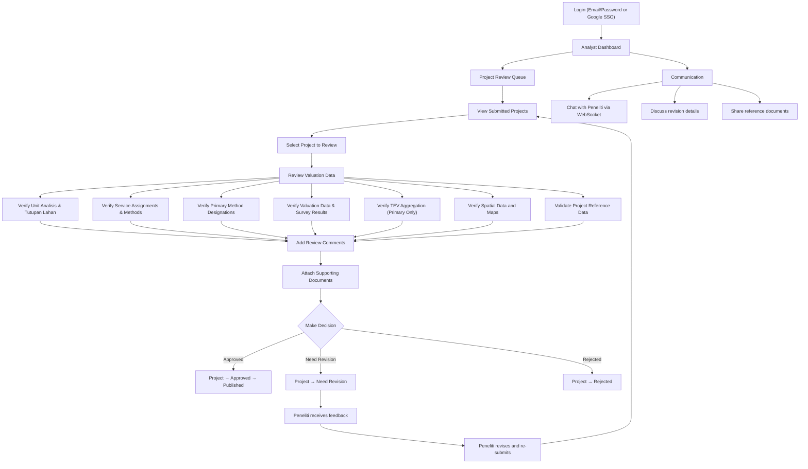
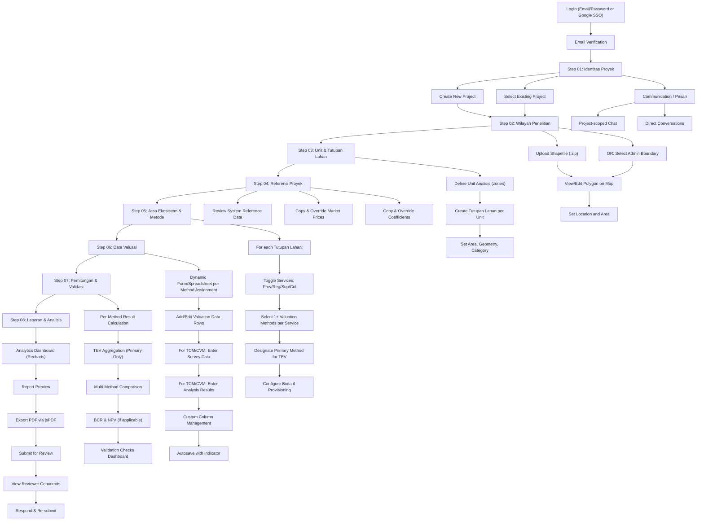
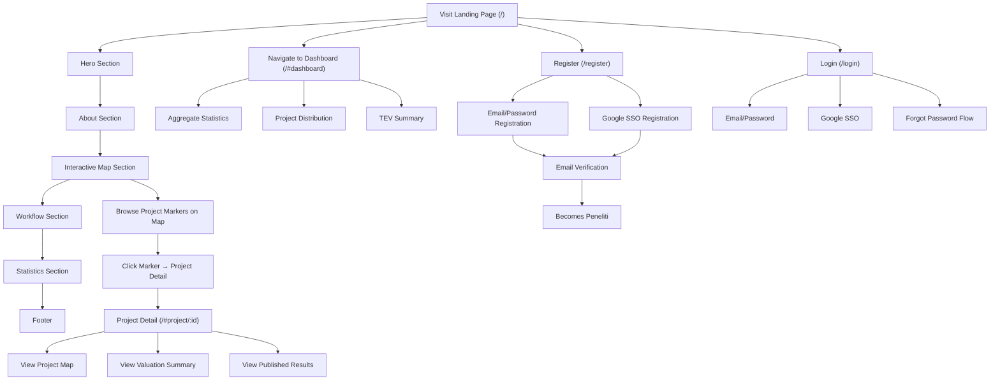
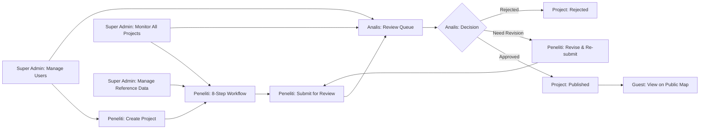

# User Flows per Role

## PKSPL IPB — Coastal & Marine Ecosystem Economic Valuation System

### Aligned with Redesign v2

---

## Roles Overview

| Role | Access Level | Primary Responsibility |
|------|-------------|----------------------|
| **Super Admin** | Full system access | System administration, reference data, user management |
| **Analis** | Review-level access | Validate and review valuation data from Peneliti |
| **Peneliti** | Project-scoped access | Conduct 8-step ecosystem valuation research workflow |
| **Guest / Public** | Read-only public access | View published projects, statistics, and landing page |

> [!NOTE]
> The **Analis** role was removed from the production codebase in migration `2026_09_29_000001`. It is documented here as part of the original system design where the Analis performs validation before publication.

---

## 1. Super Admin Flow

### 1.1 Access Control
- **Routes**: `/admin/*`
- **Middleware**: `role:Super Admin,Admin,Administrator`
- **Can also access**: `/peneliti/*` (researcher workflow, minus "01 Proyek" step)

### 1.2 Flow Diagram

```mermaid
flowchart TD
    A["Login (Email/Password or Google SSO)"] --> B["Admin Dashboard"]

    B --> C["Reference Data Management"]
    B --> D["User Management"]
    B --> E["Project Monitoring"]
    B --> F["Activity Log / Audit Trail"]
    B --> G["Messages / Communication"]
    B --> H["Data Verification"]
    B --> I["Policy Management"]
    B --> J["Access Researcher Workflow"]

    C --> C1["CRUD ref_ecosystem_types"]
    C --> C2["CRUD ref_valuation_methods (with input_schema)"]
    C --> C3["CRUD ref_market_prices"]
    C --> C4["CRUD ref_coefficients"]
    C --> C5["CRUD ref_land_cover_catalog"]

    D --> D1["View All Users with Presence"]
    D --> D2["Create / Edit / Delete Users"]
    D --> D3["Assign Roles"]
    D --> D4["Toggle Status: Aktif / Nonaktif"]

    E --> E1["View All System Projects"]
    E --> E2["Inspect Method Assignments"]
    E --> E3["Monitor Completion Status"]

    F --> F1["View Activity Logs"]
    F --> F2["Filter by User / Action / Date"]
    F --> F3["View Log Detail Modal"]

    G --> G1["Conversation List"]
    G --> G2["Send / Receive Messages"]
    G --> G3["Typing Indicators"]

    H --> H1["Review Submitted Data"]
    H --> H2["Quality Control Instruments"]

    I --> I1["Manage System Policies"]
    I --> I2["Manage Guidelines"]
```

### 1.3 Detailed Flow

#### Dashboard (`/admin/dashboard`)
1. View executive statistics: total projects, total TEV nationwide, active researchers
2. Monthly trends chart
3. TEV distribution visualization
4. Export dashboard as PDF

#### Reference Data Management (`/admin/reference-data`)
1. Select data category (Ecosystem Types, Valuation Methods, Market Prices, Coefficients, Land Cover Catalog)
2. View existing records in searchable table
3. Create new record → fill form → save
4. Edit existing record → modify → save
5. Delete record → confirmation → remove (soft-delete via `is_active` flag)
6. For **Valuation Methods**: edit `input_schema` JSON that defines required/optional fields for dynamic form rendering

#### User Management (`/admin/users`)
1. View user list with online/offline/last seen indicators
2. Search and filter users by role, status, name
3. Create new user: name, email, role assignment, password
4. Edit user details, change role
5. Toggle user status (Aktif ↔ Nonaktif)
6. View user profile detail modal

#### Project Monitoring (`/admin/projects`)
1. View all system projects across all researchers
2. Filter by status, researcher, date range
3. Click project → inspect method assignments and valuation data
4. Review project completeness and data quality

#### Activity Log (`/admin/activity`)
1. View comprehensive audit log
2. Filter by user, action type, date range, project
3. Click log entry → detail modal with full metadata (JSONB)

#### Messages (`/admin/messages`)
1. View conversation list (direct and project-scoped)
2. Select conversation → view message thread
3. Send message with optional attachments
4. See typing indicators and read receipts

#### Data Verification (`/admin/verifikasi-data`)
1. Review queue of submitted valuation data
2. Inspect data accuracy against reference standards
3. Approve or request revision

#### Policy Management (`/admin/kebijakan`)
1. View existing system policies
2. Create/edit policy documents
3. Publish guidelines for researchers

---

## 2. Analis (Analyst) Flow

> [!IMPORTANT]
> This role is documented as part of the original design. In this model, the Analis serves as an intermediate reviewer between the Peneliti and publication, using the `validasi_analyst` table and project `status` field.

### 2.1 Access Control
- **Routes**: `/analyst/*`, review endpoints
- **Primary Table**: `validasi_analyst` (id_validasi, id_proyek, id_user, status_validasi, catatan, tanggal_validasi)
- **Project Status Flow**: `Draft → Submitted → [Analis Review] → Approved / Need Revision / Rejected → Published`

### 2.2 Flow Diagram

### 2.3 Detailed Flow

#### Dashboard
1. View assigned projects pending review
2. Statistics overview: pending reviews, completed this month, revision rate

#### Review Queue
1. View list of projects with status `Submitted`
2. Filter by researcher, project location, date submitted
3. Sort by priority / submission date

#### Validation Workflow
1. Open submitted project
2. Navigate through each section:
   - **Spatial Data**: Verify map polygons, boundaries, land cover areas match shapefile
   - **Unit Analisis & Tutupan Lahan**: Confirm analysis unit definitions, land cover classifications and area calculations
   - **Project References**: Verify `project_market_prices` and `project_coefficients` have valid sources and appropriate values
   - **Service & Method Assignments**: Check that each active service on each land cover has appropriate method(s) selected
   - **Multi-Method Verification**: Verify exactly one primary method per service per land cover, and that supporting methods are justified
   - **Valuation Data**: Verify data completeness and accuracy for each method assignment
   - **Survey Data (TCM/CVM)**: Verify sample sizes, analysis parameters, and statistical results in `method_analyses`
   - **TEV Aggregation**: Cross-check that only primary method results enter TEV sum; verify TEV component mapping is appropriate
   - **BCR & NPV**: Validate discount rate, analysis period, present value calculations

3. Create review record in `reviews` table
4. Add comments per section → `review_comments` with nested replies
5. Mention specific users in comments → `comment_mentions`
6. Attach reference documents → `comment_attachments`

#### Decision Making
1. Select decision: **Approved**, **Need Revision**, or **Rejected**
2. Add decision notes explaining rationale
3. Record in `validasi_analyst` table with `tanggal_validasi`
4. System updates project `status` accordingly
5. Notification sent to Peneliti

#### Communication
1. Real-time chat via WebSocket (Laravel Reverb)
2. Project-scoped conversations
3. File sharing for reference data
4. Typing indicators and presence

---

## 3. Peneliti (Researcher) Flow — 8-Step Workflow

### 3.1 Access Control
- **Routes**: `/peneliti/*`
- **Middleware**: `role:Super Admin,Admin,Administrator,Peneliti`
- **Scope**: Own projects only

### 3.2 Flow Diagram

### 3.3 Detailed Step-by-Step

#### Step 01 — Identitas Proyek (Project Identity) `/peneliti/projects`
1. View list of own projects (cards with name, code, location, status)
2. **Create New Project**:
   - Enter project name (`nama_proyek`)
   - Enter valuation objective (`tujuan_valuasi`)
   - Select year (`tahun`)
   - Set economic parameters: `base_year`, `discount_rate`, `analysis_period`, `currency`
   - Add description (`deskripsi`)
   - Auto-generated project code (e.g., `PKS-A3X8K1`)
3. Edit or delete existing project
4. Click project → enters 8-step workflow

#### Step 02 — Wilayah Penelitian (Study Area) `/peneliti/projects/:id/maps`
1. View interactive Leaflet map
2. **Option A**: Upload Shapefile (.zip)
   - Drag-and-drop or file picker → `UploadShpModal`
   - shpjs parses in-browser → extracts GeoJSON
   - Polygon rendered on map → stored as `geometry` JSON
3. **Option B**: Administrative Boundary Picker
   - Select Provinsi → Kabupaten/Kota → Kecamatan → Desa/Kelurahan
   - Boundary polygon loaded from `administrative_boundaries` (PostGIS)
4. View/edit polygon on map with layer controls
5. Set project latitude, longitude, area (`luas`), and unit (`satuan_luas`)

#### Step 03 — Unit Analisis & Tutupan Lahan `/peneliti/projects/:id/units`
1. Define analysis units (zones) for the project area
2. For each unit: set name, code, area, optional geometry
3. Under each unit, define **Tutupan Lahan** (Land Cover Types):
   - Name, category (from `ref_land_cover_catalog` or free text), area, optional geometry
4. Tutupan Lahan is the anchor entity for all downstream valuation data

#### Step 04 — Referensi Proyek (Project References) `/peneliti/projects/:id/references`
1. Review system reference data (read-only): `ref_market_prices`, `ref_coefficients`
2. Copy & override market prices for project context → `project_market_prices`
3. Copy & override coefficients → `project_coefficients`
4. Add custom project-specific prices/coefficients not in system catalog
5. Overrides are frozen once used in calculations (immutability rule)

#### Step 05 — Jasa Ekosistem & Metode (Services & Methods) `/peneliti/projects/:id/services-methods`
1. For each Tutupan Lahan:
   - Toggle which ecosystem services are active:
     - ✅ Provisioning Services (Jasa Penyediaan)
     - ✅ Regulating Services (Jasa Pengaturan)
     - ✅ Supporting Services (Jasa Pendukung)
     - ✅ Cultural Services (Jasa Budaya)
   - Select **one or more** valuation methods per active service
   - Designate exactly **one primary method** per service (for TEV aggregation)
   - Additional methods are **supporting** (results shown in report for comparison)
   - Optionally override TEV component mapping per method assignment
   - For Provisioning: configure biota type (Flora / Fauna)
2. Saved to `service_method_assignments` table

#### Step 06 — Data Valuasi (Valuation Data) `/peneliti/projects/:id/valuation-data`
1. Dynamic form/spreadsheet per method assignment (driven by `ref_valuation_methods.input_schema`)
2. Add/edit data rows → stored in `valuation_rows` with flexible `row_data` JSON
3. For survey methods (TCM, CVM, HPM): enter per-respondent survey data
4. For survey methods: enter statistical analysis results in `method_analyses`
5. Custom column management for additional fields
6. Excel import via SheetJS
7. Autosave with `AutosaveIndicator`

#### Step 07 — Perhitungan & Validasi (Calculation & Validation) `/peneliti/projects/:id/calculation`
1. Per-method result calculation → stored in `method_results`
2. TEV aggregation — only primary methods enter TEV sum
3. Multi-method comparison table (primary vs supporting results)
4. TEV decomposition: TEV = DUV + IUV + OV + EV + BV
5. BCR & NPV calculation (if applicable) using project economic parameters
6. Validation checks dashboard:
   - Missing primary method → 🔴 Error
   - No data rows → 🟡 Warning
   - Zero result value → 🟡 Warning
   - TEV component overlap → 🟡 Warning
   - Analysis missing (TCM/CVM) → 🟡 Warning
   - Negative NPV → 🟢 Info

#### Step 08 — Laporan & Analisis (Report & Analysis) `/peneliti/projects/:id/report`
1. Analytics Dashboard (Recharts):
   - TEV composition per land cover (stacked bar)
   - TEV by service category (pie chart)
   - Multi-method comparison (grouped bar showing primary vs supporting results)
   - Benefits vs Costs over time (line chart)
2. Report Preview: comprehensive valuation report
3. Export PDF via jsPDF + html2canvas
4. Submit project for review (to Analis/Admin)
5. View review comments with threaded replies
6. Respond to feedback, re-submit after revision

#### Communication `/peneliti/projects/:id/messages`
1. View conversation list (project-scoped and direct)
2. Select conversation → message thread
3. Send text messages (encrypted via SafeEncryptedString)
4. Attach files (images, documents)
5. Reply to specific messages
6. See typing indicators and read receipts
7. Global chat notification bell (`GlobalChatNotification`)
8. Configure notification preferences (email/in-app toggles)

---

## 4. Guest / Public Flow

### 4.1 Access Control
- **Routes**: `/` (landing page), `/#dashboard`, `/#project/:id`
- **Auth Required**: No (except registration)
- **Access**: Read-only public data

### 4.2 Flow Diagram

### 4.3 Detailed Flow

#### Landing Page (`/`)
1. **Hero Section** — Introduction to PKSPL Valuation System
2. **About Section** — Platform description and mission
3. **Map Section** — Interactive Leaflet map with markers showing distribution of valuation projects across Indonesia
   - Click marker → navigate to project detail (`/#project/:id`)
4. **Workflow Section** — Visual explanation of the 8-step research process
5. **Statistics Section** — Aggregate numbers (total projects, total researchers, TEV summary)
6. **Footer** — Contact info, institutional links

#### Public Dashboard (`/#dashboard`)
1. Aggregate statistics cards
2. Project distribution by region
3. TEV summary across all published projects
4. Monthly activity trends

#### Project Detail (`/#project/:id`)
1. Project metadata (name, location, year, researcher)
2. Map visualization of project boundary
3. Summary of valuation results (if published)
4. TEV breakdown visualization with multi-method comparison

#### Registration (`/register`)
1. Fill registration form (name, email, password)
2. OR click "Login with Google" for SSO
3. Email verification link sent
4. Verify email → account activated as Peneliti role
5. Redirect to researcher workflow

---

## 5. Cross-Role Interaction Flow

### 5.1 Project Lifecycle with All Roles

### 5.2 Communication Matrix

| From \ To | Super Admin | Analis | Peneliti | Guest |
|-----------|:-----------:|:------:|:--------:|:-----:|
| **Super Admin** | ✅ | ✅ | ✅ | ❌ |
| **Analis** | ✅ | ✅ | ✅ | ❌ |
| **Peneliti** | ✅ | ✅ | ✅ | ❌ |
| **Guest** | ❌ | ❌ | ❌ | ❌ |

---

*User flows aligned with Redesign v2 — PKSPL IPB Valuation System*
