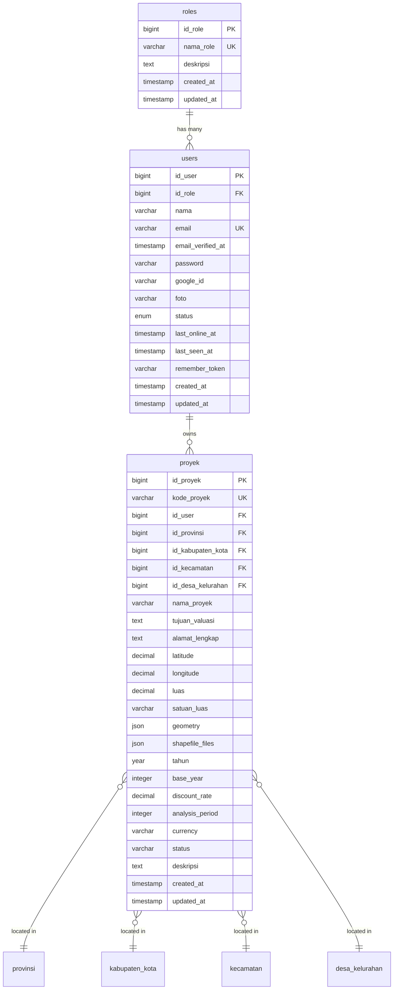
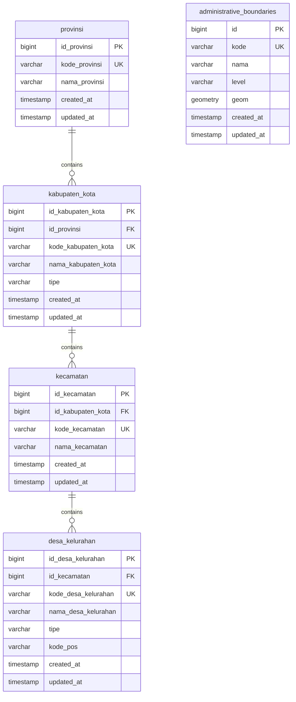
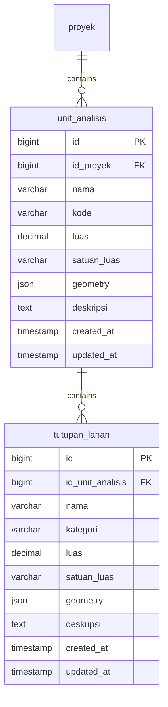
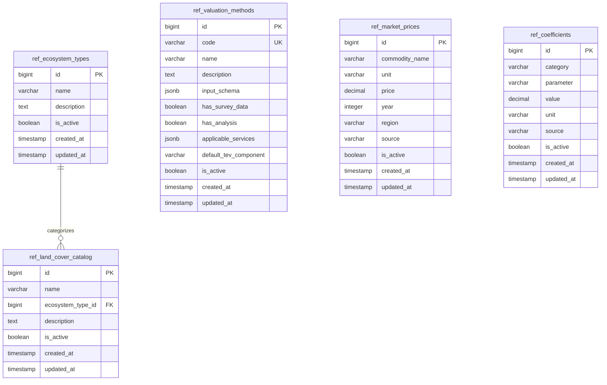
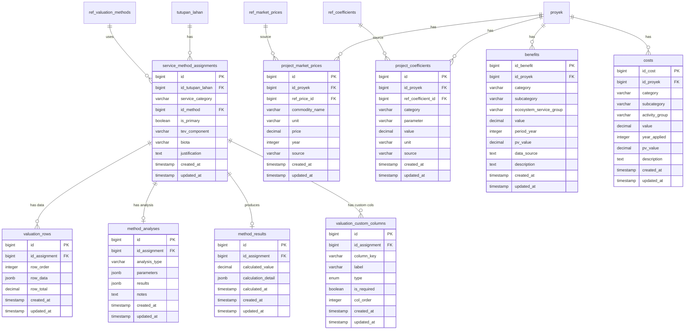
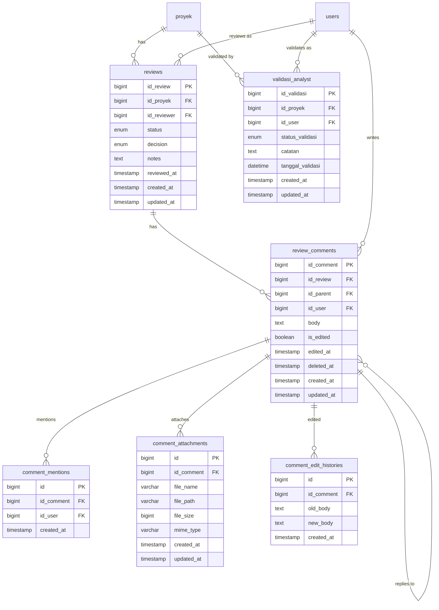
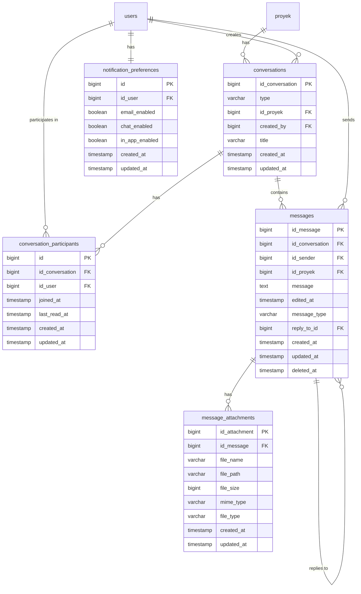
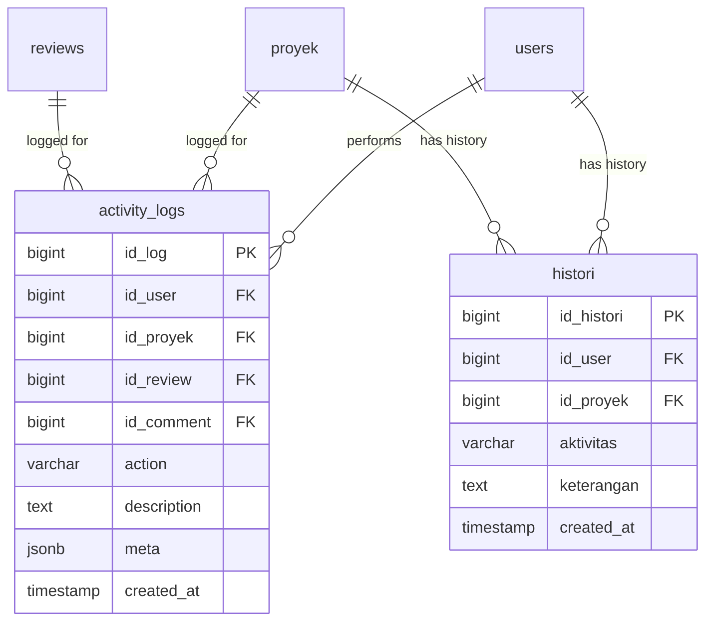

# Entity Relationship Diagram (ERD)

## PKSPL IPB — Coastal & Marine Ecosystem Economic Valuation System

### Aligned with Redesign v2

---

## Schema Overview

The database consists of **~35 tables** organized into 8 logical domains:

| # | Domain | Tables | Description |
|---|--------|--------|-------------|
| 1 | Core | 3 | Users, Roles, Projects (with economic parameters) |
| 2 | Geography | 5 | Administrative hierarchy + PostGIS boundaries |
| 3 | Ecosystem & Land Cover | 2 | Unit Analisis, Tutupan Lahan |
| 4 | Reference Data | 5 | Admin-managed system catalogs |
| 5 | Valuation | 9 | Multi-method valuation engine |
| 6 | Review & Validation | 7 | Reviews, Comments, Analyst Validation |
| 7 | Communication | 5 | Chat, Messages, Notifications |
| 8 | Audit | 2 | Activity Logs, History |

---

## 1. Core ERD — Users, Roles & Projects

### 1.1 Diagram



### 1.2 Table Descriptions

#### `roles`
| Column | Type | Constraints | Description |
|--------|------|-------------|-------------|
| `id_role` | BIGINT | PK, Auto-increment | Role unique identifier |
| `nama_role` | VARCHAR(50) | UNIQUE, NOT NULL | Role name: 'Super Admin', 'Analis', 'Peneliti', 'Guest' |
| `deskripsi` | TEXT | NULLABLE | Role description |
| `created_at` | TIMESTAMP | | Creation timestamp |
| `updated_at` | TIMESTAMP | | Last update timestamp |

#### `users`
| Column | Type | Constraints | Description |
|--------|------|-------------|-------------|
| `id_user` | BIGINT | PK, Auto-increment | User unique identifier |
| `id_role` | BIGINT | FK → `roles.id_role`, CASCADE UPDATE, RESTRICT DELETE | Assigned role |
| `nama` | VARCHAR(100) | NOT NULL | Full name |
| `email` | VARCHAR(100) | UNIQUE, NOT NULL | Email address |
| `email_verified_at` | TIMESTAMP | NULLABLE | Email verification timestamp |
| `password` | VARCHAR(255) | NOT NULL | Hashed password |
| `google_id` | VARCHAR(255) | NULLABLE | Google OAuth ID |
| `foto` | VARCHAR(255) | NULLABLE | Profile photo path |
| `status` | ENUM | DEFAULT 'Aktif' | 'Aktif' or 'Nonaktif' |
| `last_online_at` | TIMESTAMP | NULLABLE | Last online presence |
| `last_seen_at` | TIMESTAMP | NULLABLE | Last page visit |
| `remember_token` | VARCHAR(100) | NULLABLE | Remember me token |

#### `proyek`
| Column | Type | Constraints | Description |
|--------|------|-------------|-------------|
| `id_proyek` | BIGINT | PK, Auto-increment | Project unique identifier |
| `kode_proyek` | VARCHAR(50) | UNIQUE, NULLABLE | Auto-generated code (e.g., PKS-A3X8K1) |
| `id_user` | BIGINT | FK → `users.id_user` | Project owner |
| `id_provinsi` | BIGINT | FK, NULLABLE | Province location |
| `id_kabupaten_kota` | BIGINT | FK, NULLABLE | Regency/city location |
| `id_kecamatan` | BIGINT | FK, NULLABLE | District location |
| `id_desa_kelurahan` | BIGINT | FK, NULLABLE | Village location |
| `nama_proyek` | VARCHAR(150) | NOT NULL | Project name |
| `tujuan_valuasi` | TEXT | NOT NULL | Valuation objective |
| `alamat_lengkap` | TEXT | NULLABLE | Full address |
| `latitude` | DECIMAL(10,6) | NULLABLE | GPS latitude |
| `longitude` | DECIMAL(10,6) | NULLABLE | GPS longitude |
| `luas` | DECIMAL(15,2) | NULLABLE | Project area size |
| `satuan_luas` | VARCHAR(20) | NULLABLE | Area unit (ha, km², etc.) |
| `geometry` | JSON | NULLABLE | GeoJSON boundary polygon |
| `shapefile_files` | JSON | NULLABLE | Uploaded shapefile metadata |
| `tahun` | YEAR | NOT NULL | Research year |
| `base_year` | INTEGER | NOT NULL | Base year for economic calculations |
| `discount_rate` | DECIMAL(6,4) | NOT NULL | Discount rate for NPV (e.g., 0.0500 = 5%) |
| `analysis_period` | INTEGER | NOT NULL | Number of years for NPV analysis |
| `currency` | VARCHAR(10) | NOT NULL, DEFAULT 'IDR' | Currency code |
| `status` | VARCHAR(50) | DEFAULT 'Draft' | Draft, Submitted, Need Revision, Approved, Published |
| `deskripsi` | TEXT | NULLABLE | Description |

> [!NOTE]
> Economic parameters (`base_year`, `discount_rate`, `analysis_period`, `currency`) were previously in a separate `project_valuation_settings` table. They are now embedded directly in `proyek` for simplicity.

---

## 2. Geographic ERD — Administrative Hierarchy

### 2.1 Diagram



### 2.2 Table Descriptions

#### `administrative_boundaries`
| Column | Type | Constraints | Description |
|--------|------|-------------|-------------|
| `id` | BIGINT | PK | Boundary identifier |
| `kode` | VARCHAR | UNIQUE | Administrative code |
| `nama` | VARCHAR | NOT NULL | Boundary name |
| `level` | VARCHAR | NOT NULL | Hierarchy level (provinsi, kab_kota, kecamatan, desa_kel) |
| `geom` | GEOMETRY | PostGIS | Spatial polygon geometry for boundary lookup |

---

## 3. Ecosystem & Land Cover ERD

### 3.1 Diagram



### 3.2 Table Descriptions

#### `unit_analisis` — Analysis Units (replaces `indexes`)
| Column | Type | Constraints | Description |
|--------|------|-------------|-------------|
| `id` | BIGINT | PK, Auto-increment | Unit identifier |
| `id_proyek` | BIGINT | FK → `proyek`, CASCADE DELETE | Parent project |
| `nama` | VARCHAR(150) | NOT NULL | Unit name (e.g., "Zona Pesisir Utara") |
| `kode` | VARCHAR(100) | UNIQUE composite with `id_proyek` | Unit code |
| `luas` | DECIMAL(15,2) | NULLABLE | Area size |
| `satuan_luas` | VARCHAR(20) | NULLABLE | Area unit |
| `geometry` | JSON | NULLABLE | GeoJSON polygon |
| `deskripsi` | TEXT | NULLABLE | Description |

#### `tutupan_lahan` — Land Cover Types (replaces `jenis_tutupan_lahan`)
| Column | Type | Constraints | Description |
|--------|------|-------------|-------------|
| `id` | BIGINT | PK, Auto-increment | Land cover identifier |
| `id_unit_analisis` | BIGINT | FK → `unit_analisis`, CASCADE DELETE | Parent unit |
| `nama` | VARCHAR(150) | NOT NULL | Land cover name (e.g., "Mangrove Primer") |
| `kategori` | VARCHAR(100) | NULLABLE | Category (from `ref_land_cover_catalog` or free text) |
| `luas` | DECIMAL(15,2) | NULLABLE | Area |
| `satuan_luas` | VARCHAR(20) | NULLABLE | Area unit |
| `geometry` | JSON | NULLABLE | GeoJSON polygon |
| `deskripsi` | TEXT | NULLABLE | Description |

> [!NOTE]
> The following tables from the old design are removed:
> - `ekosistem` → replaced by `ref_ecosystem_types` (see Section 4)
> - `area_terdampak` → redundant with `unit_analisis`
> - `indexes` → renamed to `unit_analisis`
> - `jenis_tutupan_lahan` → renamed to `tutupan_lahan`

---

## 4. Reference Data ERD — Admin-Managed Catalogs

### 4.1 Diagram



### 4.2 Table Descriptions

#### `ref_ecosystem_types` — Ecosystem Type Catalog (replaces `ekosistem`)
| Column | Type | Constraints | Description |
|--------|------|-------------|-------------|
| `id` | BIGINT | PK | Ecosystem type identifier |
| `name` | VARCHAR(150) | NOT NULL | e.g., "Mangrove", "Terumbu Karang", "Lamun", "Pantai Berpasir" |
| `description` | TEXT | NULLABLE | Ecosystem description |
| `is_active` | BOOLEAN | DEFAULT true | Admin can deactivate without deleting |

#### `ref_valuation_methods` — Valuation Method Catalog (replaces `metode_valuasi`)
| Column | Type | Constraints | Description |
|--------|------|-------------|-------------|
| `id` | BIGINT | PK | Method identifier |
| `code` | VARCHAR(50) | UNIQUE | Slug: `market-price`, `tcm`, `cvm`, `replacement-cost`, `eop`, `hpm`, `abm`, `benefit-transfer` |
| `name` | VARCHAR(150) | NOT NULL | Display name |
| `description` | TEXT | NULLABLE | Method description |
| `input_schema` | JSONB | NOT NULL | Defines required/optional fields for data rows. Used for dynamic form rendering and validation. |
| `has_survey_data` | BOOLEAN | DEFAULT false | `true` for TCM, CVM, HPM, CE — methods requiring per-respondent data |
| `has_analysis` | BOOLEAN | DEFAULT false | `true` if method requires a separate statistical analysis step |
| `applicable_services` | JSONB | NOT NULL | Array of service categories, e.g., `["provisioning", "cultural"]` |
| `default_tev_component` | VARCHAR(10) | NOT NULL | Default TEV component: `DUV`, `IUV`, `OV`, `EV`, `BV` |
| `is_active` | BOOLEAN | DEFAULT true | Admin can deactivate |

**Example `input_schema` for Market Price method:**
```json
{
  "fields": [
    { "key": "object_name", "label": "Nama Objek", "type": "text", "required": true },
    { "key": "latin_name", "label": "Nama Latin", "type": "text", "required": false },
    { "key": "local_name", "label": "Nama Daerah", "type": "text", "required": false },
    { "key": "productivity", "label": "Produktivitas", "type": "decimal", "required": true, "unit_field": "productivity_unit" },
    { "key": "market_price", "label": "Harga Pasar (Rp)", "type": "decimal", "required": true },
    { "key": "utilized_area", "label": "Luas Pemanfaatan", "type": "decimal", "required": true, "unit_field": "area_unit" },
    { "key": "reference", "label": "Referensi", "type": "text", "required": false }
  ],
  "formula": "productivity * market_price * utilized_area",
  "result_field": "total_value"
}
```

#### `ref_market_prices` — National/Regional Commodity Price Catalog
| Column | Type | Constraints | Description |
|--------|------|-------------|-------------|
| `id` | BIGINT | PK | Price identifier |
| `commodity_name` | VARCHAR(150) | NOT NULL | Commodity name |
| `unit` | VARCHAR(50) | NOT NULL | e.g., "kg", "ton", "ekor" |
| `price` | DECIMAL(20,2) | NOT NULL | Price value |
| `year` | INTEGER | NOT NULL | Price year |
| `region` | VARCHAR(150) | NULLABLE | Region scope (national, province name, etc.) |
| `source` | VARCHAR(200) | NULLABLE | Data source (BPS, research publication, etc.) |
| `is_active` | BOOLEAN | DEFAULT true | Active flag |

#### `ref_coefficients` — Environmental Coefficients Catalog
| Column | Type | Constraints | Description |
|--------|------|-------------|-------------|
| `id` | BIGINT | PK | Coefficient identifier |
| `category` | VARCHAR(100) | NOT NULL | e.g., "carbon_sequestration", "nutrient_cycling" |
| `parameter` | VARCHAR(150) | NOT NULL | e.g., "carbon_absorption_rate" |
| `value` | DECIMAL(15,6) | NOT NULL | Coefficient value |
| `unit` | VARCHAR(50) | NULLABLE | Unit of measurement |
| `source` | VARCHAR(200) | NULLABLE | Data source |
| `is_active` | BOOLEAN | DEFAULT true | Active flag |

#### `ref_land_cover_catalog` — Standard Land Cover Names (NEW)
| Column | Type | Constraints | Description |
|--------|------|-------------|-------------|
| `id` | BIGINT | PK | Catalog entry identifier |
| `name` | VARCHAR(150) | NOT NULL | e.g., "Mangrove Primer", "Mangrove Sekunder", "Padang Lamun" |
| `ecosystem_type_id` | BIGINT | FK → `ref_ecosystem_types` | Parent ecosystem type |
| `description` | TEXT | NULLABLE | Description |
| `is_active` | BOOLEAN | DEFAULT true | Active flag |

---

## 5. Valuation ERD — Multi-Method Engine

### 5.1 Diagram



### 5.2 Table Descriptions

#### `service_method_assignments` — Central Linking Table (replaces `area_service_configs`)
| Column | Type | Constraints | Description |
|--------|------|-------------|-------------|
| `id` | BIGINT | PK | Assignment identifier |
| `id_tutupan_lahan` | BIGINT | FK → `tutupan_lahan`, CASCADE DELETE | Land cover |
| `service_category` | VARCHAR(20) | NOT NULL | `provisioning`, `regulating`, `supporting`, `cultural` |
| `id_method` | BIGINT | FK → `ref_valuation_methods` | Selected valuation method |
| `is_primary` | BOOLEAN | NOT NULL, DEFAULT true | Primary method for TEV aggregation? |
| `tev_component` | VARCHAR(5) | NOT NULL | `DUV`, `IUV`, `OV`, `EV`, `BV` |
| `biota` | VARCHAR(20) | NULLABLE | `flora`, `fauna` — for provisioning |
| `justification` | TEXT | NULLABLE | Why this method was chosen (for report) |
| | | **UNIQUE** | (`id_tutupan_lahan`, `service_category`, `id_method`) |

> [!IMPORTANT]
> **Application-level constraint:** For each (`id_tutupan_lahan`, `service_category`), exactly one assignment must have `is_primary = true`. This is enforced in the controller/service layer, not at the database level, because PostgreSQL partial unique indexes on boolean conditions add complexity.

#### `valuation_rows` — Flexible Valuation Data Rows
| Column | Type | Constraints | Description |
|--------|------|-------------|-------------|
| `id` | BIGINT | PK | Row identifier |
| `id_assignment` | BIGINT | FK → `service_method_assignments`, CASCADE DELETE | Parent method assignment |
| `row_order` | INTEGER | DEFAULT 0 | Display order |
| `row_data` | JSONB | NOT NULL | Flexible key-value data validated against method `input_schema` |
| `row_total` | DECIMAL(20,2) | DEFAULT 0 | Row total economic value |

#### `method_analyses` — Statistical Analysis Results
| Column | Type | Constraints | Description |
|--------|------|-------------|-------------|
| `id` | BIGINT | PK | Analysis identifier |
| `id_assignment` | BIGINT | FK → `service_method_assignments`, CASCADE DELETE, UNIQUE | One analysis per assignment |
| `analysis_type` | VARCHAR(50) | NOT NULL | e.g., `zonal_tcm`, `dichotomous_choice_logit`, `open_ended_wtp` |
| `parameters` | JSONB | NULLABLE | Analysis input parameters (model type, variables, etc.) |
| `results` | JSONB | NULLABLE | Analysis output (coefficients, R², consumer surplus, mean WTP, etc.) |
| `notes` | TEXT | NULLABLE | Researcher notes on analysis |

#### `method_results` — Calculated Method Results
| Column | Type | Constraints | Description |
|--------|------|-------------|-------------|
| `id` | BIGINT | PK | Result identifier |
| `id_assignment` | BIGINT | FK → `service_method_assignments`, CASCADE DELETE, UNIQUE | One result per assignment |
| `calculated_value` | DECIMAL(20,2) | NOT NULL | Total economic value from this method |
| `calculation_detail` | JSONB | NULLABLE | Breakdown of how value was calculated |
| `calculated_at` | TIMESTAMP | NOT NULL | When calculation was performed |

#### `valuation_custom_columns` — Custom Spreadsheet Columns
| Column | Type | Constraints | Description |
|--------|------|-------------|-------------|
| `id` | BIGINT | PK | Column identifier |
| `id_assignment` | BIGINT | FK → `service_method_assignments`, CASCADE DELETE | Parent assignment |
| `column_key` | VARCHAR(150) | UNIQUE composite with `id_assignment` | Column programmatic key |
| `label` | VARCHAR(200) | NOT NULL | Display label |
| `type` | ENUM | NOT NULL | 'text', 'integer', 'decimal', 'date', 'boolean' |
| `is_required` | BOOLEAN | DEFAULT false | Required field flag |
| `col_order` | INTEGER | DEFAULT 0 | Column display order |

#### `project_market_prices` — Project-Specific Market Prices
| Column | Type | Constraints | Description |
|--------|------|-------------|-------------|
| `id` | BIGINT | PK | Price identifier |
| `id_proyek` | BIGINT | FK → `proyek`, CASCADE DELETE | Project scope |
| `ref_price_id` | BIGINT | FK → `ref_market_prices`, NULLABLE | Source reference (NULL = custom entry) |
| `commodity_name` | VARCHAR(150) | NOT NULL | Copied or custom commodity name |
| `unit` | VARCHAR(50) | NOT NULL | Unit |
| `price` | DECIMAL(20,2) | NOT NULL | Price value |
| `year` | INTEGER | NOT NULL | Price year |
| `source` | VARCHAR(200) | NULLABLE | Data source |

#### `project_coefficients` — Project-Specific Coefficients
| Column | Type | Constraints | Description |
|--------|------|-------------|-------------|
| `id` | BIGINT | PK | Coefficient identifier |
| `id_proyek` | BIGINT | FK → `proyek`, CASCADE DELETE | Project scope |
| `ref_coefficient_id` | BIGINT | FK → `ref_coefficients`, NULLABLE | Source reference (NULL = custom) |
| `category` | VARCHAR(100) | NOT NULL | Category |
| `parameter` | VARCHAR(150) | NOT NULL | Parameter name |
| `value` | DECIMAL(15,6) | NOT NULL | Coefficient value |
| `unit` | VARCHAR(50) | NULLABLE | Unit |
| `source` | VARCHAR(200) | NULLABLE | Data source |

#### `benefits` — Project Benefits for BCR/NPV
| Column | Type | Constraints | Description |
|--------|------|-------------|-------------|
| `id_benefit` | BIGINT | PK | Benefit identifier |
| `id_proyek` | BIGINT | FK → `proyek`, CASCADE DELETE | Parent project |
| `category` | VARCHAR(100) | NOT NULL | Benefit category |
| `subcategory` | VARCHAR(100) | NULLABLE | Subcategory |
| `ecosystem_service_group` | VARCHAR(100) | NULLABLE | Service group |
| `value` | DECIMAL(20,2) | NOT NULL | Benefit value |
| `period_year` | INTEGER | NOT NULL | Year period |
| `pv_value` | DECIMAL(20,2) | NULLABLE | Present value |
| `data_source` | TEXT | NULLABLE | Source reference |
| `description` | TEXT | NULLABLE | Description |

#### `costs` — Project Costs for BCR/NPV
| Column | Type | Constraints | Description |
|--------|------|-------------|-------------|
| `id_cost` | BIGINT | PK | Cost identifier |
| `id_proyek` | BIGINT | FK → `proyek`, CASCADE DELETE | Parent project |
| `category` | VARCHAR(100) | NOT NULL | Cost category |
| `subcategory` | VARCHAR(100) | NULLABLE | Subcategory |
| `activity_group` | VARCHAR(100) | NULLABLE | Activity group |
| `value` | DECIMAL(20,2) | NOT NULL | Cost value |
| `year_applied` | INTEGER | NOT NULL | Year applied |
| `pv_value` | DECIMAL(20,2) | NULLABLE | Present value |
| `description` | TEXT | NULLABLE | Description |

### 5.3 Tables Removed — Migration Guide

| Old Table | Replacement | Reason |
|-----------|-------------|--------|
| `provisioning_service` | `valuation_rows` + method `input_schema` | Consolidated into flexible data model |
| `regulating_service` | `valuation_rows` + method `input_schema` | Consolidated |
| `supporting_service` | `valuation_rows` + method `input_schema` | Consolidated |
| `cultural_service` | `valuation_rows` + method `input_schema` | Consolidated |
| `area_service_configs` | `service_method_assignments` | Redesigned for multi-method support |
| `metode_valuasi` | `ref_valuation_methods` | Enhanced with `input_schema` JSONB |
| `hasil_valuasi` | `method_results` | Per-assignment results instead of per-land-cover |
| `valuation_modules` | `service_method_assignments` + `method_analyses` | Consolidated |
| `project_valuation_settings` | Absorbed into `proyek` table | Simplified — economic params on project |
| `market_prices` | Split: `ref_market_prices` + `project_market_prices` | Clear separation of reference vs project data |
| `environmental_coefficients` | Split: `ref_coefficients` + `project_coefficients` | Clear separation |
| `eop_data` | `valuation_rows` with JSON `row_data` | Consolidated into flexible model |
| `tcm_data` | `valuation_rows` with JSON `row_data` | Consolidated |
| `tcm_analyses` | `method_analyses` | Consolidated |
| `cvm_data` | `valuation_rows` with JSON `row_data` | Consolidated |
| `cvm_analyses` | `method_analyses` | Consolidated |
| `duv_data` | `valuation_rows` with JSON `row_data` | Consolidated |
| `hpm_data` | `valuation_rows` with JSON `row_data` | Consolidated |
| `abm_data` | `valuation_rows` with JSON `row_data` | Consolidated |
| `ce_data` | `valuation_rows` with JSON `row_data` | Consolidated |
| `analisis_ai` | Removed entirely | AI components removed |
| `basis_data_ai` | Removed entirely | AI components removed |
| `ai_history` | Removed entirely | AI components removed |
| `ekosistem` | `ref_ecosystem_types` | Moved to reference catalog |
| `area_terdampak` | Removed | Redundant with `unit_analisis` |
| `valuasi_ekosistems` | Removed | Old reference pattern replaced by `ref_*` |
| `valuasi_kategori_jasas` | Removed | Old reference pattern replaced |
| `valuasi_item_valuasis` | Removed | Old reference pattern replaced |
| `index_ekosistem_summary` | Removed | Old reference pattern replaced |
| `dataset_referensi` | TBD (see Decision #9 in redesign doc) | Scope unclear |

---

## 6. Review & Validation ERD

### 6.1 Diagram



### 6.2 Table Descriptions

#### `reviews`
| Column | Type | Constraints | Description |
|--------|------|-------------|-------------|
| `id_review` | BIGINT | PK | Review identifier |
| `id_proyek` | BIGINT | FK → `proyek` | Reviewed project |
| `id_reviewer` | BIGINT | FK → `users` | Reviewer (Analis or Super Admin) |
| `status` | ENUM | DEFAULT 'Open' | 'Open', 'Resolved', 'Closed' |
| `decision` | ENUM | NULLABLE | 'Approved', 'Rejected', 'Need Revision' |
| `notes` | TEXT | NULLABLE | Decision notes |
| `reviewed_at` | TIMESTAMP | NULLABLE | Decision timestamp |

#### `validasi_analyst`
> [!NOTE]
> This table is part of the original design with the Analis role. It was dropped in migration `2026_09_29_000001` but is documented here as requested.

| Column | Type | Constraints | Description |
|--------|------|-------------|-------------|
| `id_validasi` | BIGINT | PK | Validation identifier |
| `id_proyek` | BIGINT | FK → `proyek` | Validated project |
| `id_user` | BIGINT | FK → `users` | Analyst performing validation |
| `status_validasi` | ENUM | NOT NULL | 'Pending', 'Approved', 'Rejected', 'Need Revision' |
| `catatan` | TEXT | NULLABLE | Analyst notes/comments |
| `tanggal_validasi` | DATETIME | NOT NULL | Validation date/time |

---

## 7. Communication ERD

### 7.1 Diagram



### 7.2 Table Descriptions

#### `conversations`
| Column | Type | Constraints | Description |
|--------|------|-------------|-------------|
| `id_conversation` | BIGINT | PK | Conversation identifier |
| `type` | VARCHAR(20) | DEFAULT 'direct' | 'direct' (1:1) or 'project' (project-scoped) |
| `id_proyek` | BIGINT | FK, NULLABLE | Associated project (for project-scoped chats) |
| `created_by` | BIGINT | FK → `users` | Conversation creator |
| `title` | VARCHAR(255) | NULLABLE | Conversation title (for group/project chats) |

#### `messages`
| Column | Type | Constraints | Description |
|--------|------|-------------|-------------|
| `id_message` | BIGINT | PK | Message identifier |
| `id_conversation` | BIGINT | FK → `conversations` | Parent conversation |
| `id_sender` | BIGINT | FK → `users` | Message sender |
| `id_proyek` | BIGINT | FK, NULLABLE | Project context |
| `message` | TEXT | Encrypted | Message content (SafeEncryptedString) |
| `edited_at` | TIMESTAMP | NULLABLE | Last edit timestamp |
| `message_type` | VARCHAR(20) | DEFAULT 'text' | Message type |
| `reply_to_id` | BIGINT | FK → `messages`, NULLABLE | Reply-to reference |
| `deleted_at` | TIMESTAMP | NULLABLE | Soft delete timestamp |

---

## 8. Audit ERD

### 8.1 Diagram



### 8.2 Table Descriptions

#### `activity_logs`
| Column | Type | Constraints | Description |
|--------|------|-------------|-------------|
| `id_log` | BIGINT | PK | Log identifier |
| `id_user` | BIGINT | FK, NULLABLE | Acting user |
| `id_proyek` | BIGINT | FK, NULLABLE | Related project |
| `id_review` | BIGINT | FK, NULLABLE | Related review |
| `id_comment` | BIGINT | FK, NULLABLE | Related comment |
| `action` | VARCHAR(50) | NOT NULL | Action type (create, update, delete, submit, approve, etc.) |
| `description` | TEXT | NOT NULL | Human-readable description |
| `meta` | JSONB | NULLABLE | Additional metadata |
| `created_at` | TIMESTAMP | NOT NULL | Action timestamp |

#### `histori`
| Column | Type | Constraints | Description |
|--------|------|-------------|-------------|
| `id_histori` | BIGINT | PK | History identifier |
| `id_user` | BIGINT | FK → `users` | User |
| `id_proyek` | BIGINT | FK → `proyek` | Project |
| `aktivitas` | VARCHAR(100) | NOT NULL | Activity type |
| `keterangan` | TEXT | NULLABLE | Details |
| `created_at` | TIMESTAMP | NOT NULL | Timestamp |

> [!NOTE]
> The following audit/AI tables from the old design are removed:
> - `analisis_ai` — AI Q&A per project (AI removed)
> - `basis_data_ai` — Knowledge base for AI (AI removed)
> - `ai_history` — AI interaction history (AI removed)
> - `dataset_referensi` — Reference file uploads (scope TBD, see Decision #9)

---

*ERD aligned with Redesign v2 — PKSPL IPB Valuation System*
