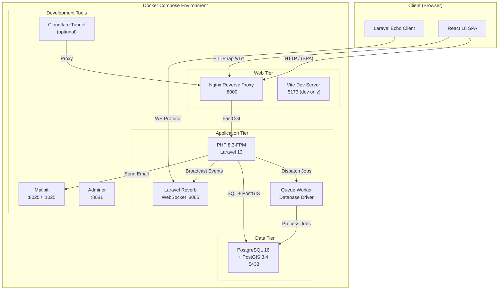
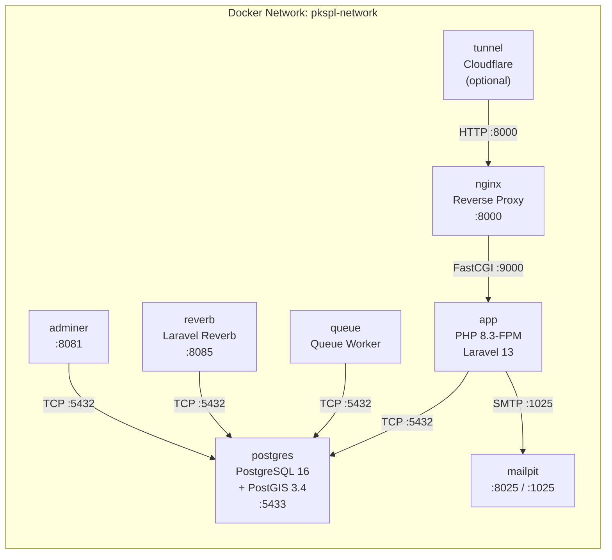
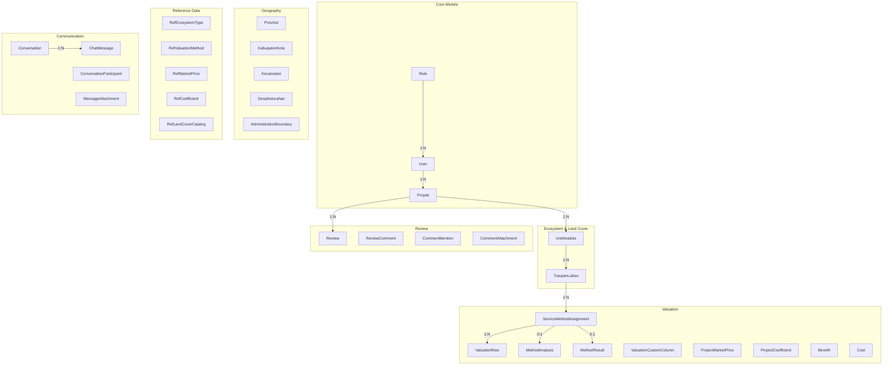
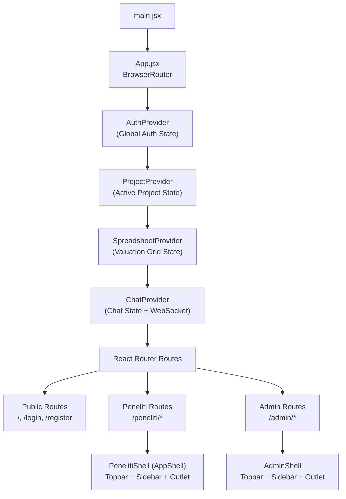
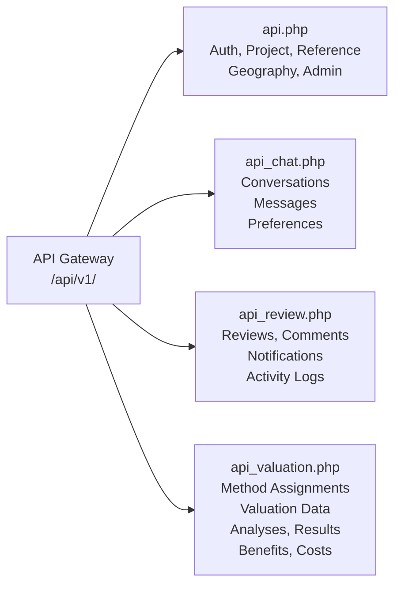
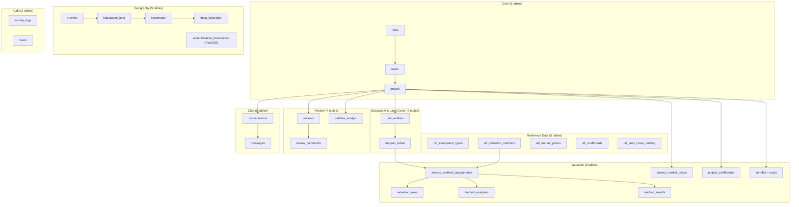
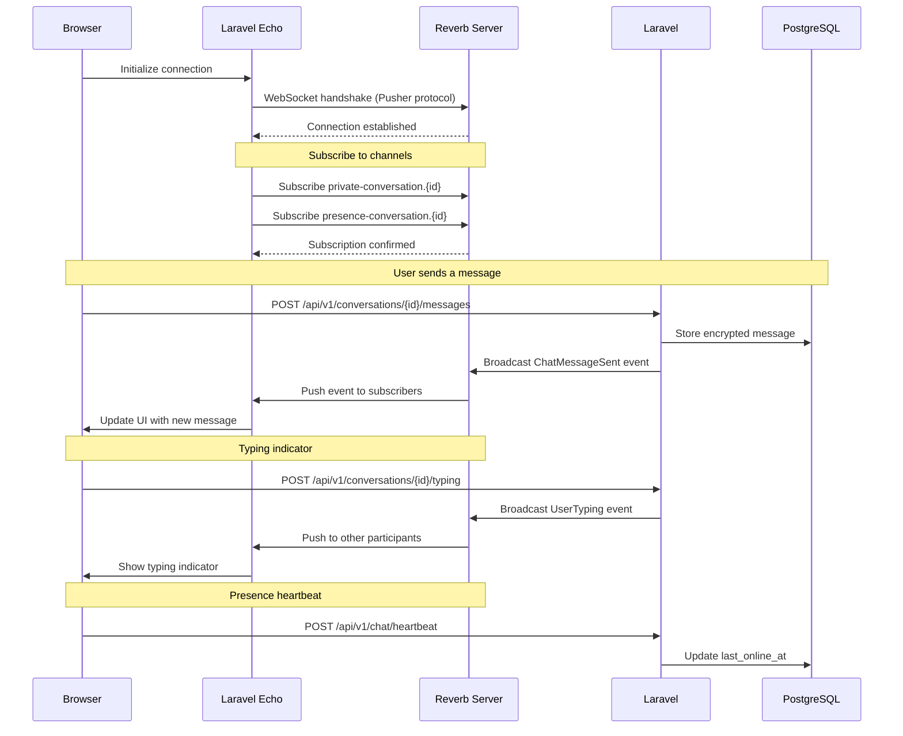
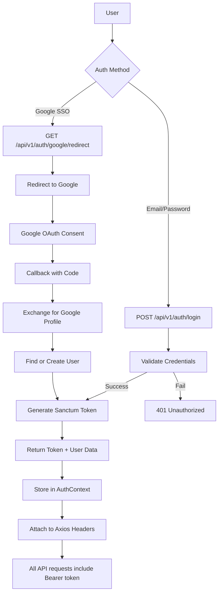

# Architecture Overview

## PKSPL IPB — Coastal & Marine Ecosystem Economic Valuation System

### Aligned with Redesign v2

---

## 1. System Architecture Overview

### 1.1 High-Level Architecture



### 1.2 Request Flow

| Request Type | Flow |
|-------------|------|
| **API Request** | Browser → Nginx (:8000) → `/api/*` → PHP-FPM → Laravel Router → Controller → Response |
| **SPA Page** | Browser → Nginx (:8000) → `/` → Serve `index.html` → React hydration |
| **WebSocket** | Browser → Echo/Pusher → Reverb (:8085) → Laravel Broadcasting → Event dispatch |
| **Dev Mode** | Browser → Vite (:5173) → HMR + React components |
| **Email** | Laravel → SMTP → Mailpit (:1025) → View at :8025 |
| **Background Job** | Controller → Queue dispatch → Queue Worker → Process → DB update |

---

## 2. Docker Container Architecture

### 2.1 Container Topology



### 2.2 Container Details

| Container | Base Image | Purpose | Ports | Depends On |
|-----------|-----------|---------|-------|------------|
| **app** | `php:8.3-fpm` | Laravel application server | Internal :9000 | postgres |
| **nginx** | `nginx:latest` | Reverse proxy, static files | :8000 → host | app |
| **postgres** | `postgis/postgis:16-3.4` | Database with spatial support | :5433 → host | — |
| **reverb** | (same as app) | WebSocket server | :8085 → host | postgres |
| **queue** | (same as app) | Background job processor | — | postgres |
| **mailpit** | `axllent/mailpit:latest` | Development email catcher | :8025, :1025 → host | — |
| **adminer** | `adminer:latest` | Database admin UI | :8081 → host | postgres |
| **tunnel** | `cloudflare/cloudflared` | Temporary public URL | — | nginx |

### 2.3 Volume Mounts

| Volume | Container | Mount Point | Purpose |
|--------|-----------|-------------|---------|
| `./src` | app, queue, reverb | `/var/www/html` | Laravel source code |
| `./docker/nginx` | nginx | `/etc/nginx/conf.d` | Nginx configuration |
| `./docker/postgres/initdb` | postgres | `/docker-entrypoint-initdb.d` | PostGIS initialization SQL |
| `pg_data` | postgres | `/var/lib/postgresql/data` | Persistent database storage |

---

## 3. Backend Architecture (Laravel 13)

### 3.1 Directory Structure

```
src/app/
├── Console/Commands/          # Artisan commands (ImportBoundaries, EncryptChat)
├── Events/                    # Broadcast events
│   ├── ChatMessageSent
│   ├── ChatMessageUpdated
│   ├── ChatMessageDeleted
│   ├── MessagesRead
│   ├── UserTyping
│   └── Review/               # Review module events
│       ├── CommentCreated
│       ├── CommentReplied
│       ├── DatasetSubmitted
│       ├── ReviewDecisionMade
│       ├── ReviewClosed
│       ├── ReviewReopened
│       ├── ReviewResolved
│       └── UserMentioned
├── Http/
│   ├── Controllers/Api/V1/   # REST API controllers (modular)
│   │   ├── Admin/             # AdminAnalytics, AdminReferenceData, AdminActivityLog
│   │   ├── Auth/              # Auth, Test
│   │   ├── Chat/              # ChatDirectory, ChatMessage, Conversation, NotificationPreference
│   │   ├── Geography/         # BoundaryLookup, Provinsi, KabupatenKota, Kecamatan, DesaKelurahan
│   │   ├── Project/           # Proyek, UnitAnalisis, TutupanLahan, ProjectReference, Dashboard, Statistics, Histori
│   │   ├── Reference/         # RefEcosystemType, RefValuationMethod, RefMarketPrice, RefCoefficient, RefLandCoverCatalog
│   │   ├── Review/            # Review, ReviewComment, CommentReply, CommentAttachment, Notification, ActivityLog, DatasetSubmission
│   │   ├── User/              # Profile, Role, User
│   │   └── Valuation/         # ServiceMethodAssignment, ValuationData, MethodAnalysis, MethodResult, Benefit, Cost
│   ├── Middleware/            # RoleMiddleware (RBAC)
│   ├── Requests/              # Form Request validation classes
│   └── Resources/             # API Resource transformers
├── Models/                    # ~40 Eloquent models
└── Policies/                  # Authorization policies
```

### 3.2 Model Layer — ~40 Eloquent Models



### 3.3 Event Broadcasting System

| Event | Channel Type | Trigger |
|-------|-------------|---------|
| `ChatMessageSent` | Private | New chat message sent |
| `ChatMessageUpdated` | Private | Message edited |
| `ChatMessageDeleted` | Private | Message deleted |
| `MessagesRead` | Private | Conversation marked as read |
| `UserTyping` | Presence | User starts/stops typing |
| `CommentCreated` | Private | New review comment |
| `CommentReplied` | Private | Reply to comment |
| `DatasetSubmitted` | Private | Project submitted for review |
| `ReviewDecisionMade` | Private | Analyst makes decision |
| `UserMentioned` | Private | User mentioned in comment |

---

## 4. Frontend Architecture (React 18)

### 4.1 Application Structure



### 4.2 Module Organization

```
src/
├── main.jsx                    # React entry point
├── App.jsx                     # Router + Context provider chain
├── contexts/
│   └── AuthContext.jsx         # Global auth state (user, token, login/logout)
├── pages/                      # Auth pages
│   ├── LoginPage.jsx
│   ├── RegisterPage.jsx
│   ├── ForgotPasswordPage.jsx
│   ├── ResetPasswordPage.jsx
│   ├── GoogleCallbackPage.jsx
│   └── EmailVerifyCallbackPage.jsx
├── components/                 # Shared components
│   ├── Navbar.jsx              # Public landing navbar
│   ├── Footer.jsx
│   ├── HeroSection.jsx
│   ├── AboutSection.jsx
│   ├── MapSection.jsx          # Public project distribution map
│   ├── StatsSection.jsx
│   ├── WorkflowSection.jsx
│   ├── ProtectedRoute.jsx      # RBAC route guard
│   ├── chat/                   # Global chat notification
│   ├── dashboard/              # Public dashboard components
│   ├── loading/                # Loading states (Skeleton, Spinner, etc.)
│   ├── map/                    # Shared map components
│   └── profile/                # Profile components
├── peneliti/                   # Researcher module
│   ├── components/
│   │   ├── layout/             # AppShell, Sidebar, Topbar, AutosaveIndicator
│   │   ├── map/                # MapView, LayerControl, Legend, PolygonDrawer
│   │   ├── spreadsheet/        # ExcelGrid, FormattedNumberInput, CustomColumnModal
│   │   ├── chat/               # ChatWindowPanel, ConversationListPanel
│   │   └── notifications/      # EmailPreview, UnifiedNotificationToast
│   ├── pages/                  # 8 workflow pages + messages
│   └── context/                # ProjectContext, SpreadsheetContext, ChatContext
├── admin/                      # Admin module
│   ├── layouts/                # AdminShell
│   ├── components/             # AdminSidebar, AdminTopbar, chat components
│   ├── pages/                  # Admin pages (dashboard, reference data, users, etc.)
│   ├── services/               # Admin API services
│   └── utils/                  # Formatters
├── services/                   # API client layer (Axios)
├── lib/                        # Library init (Echo, Reverb, Axios)
└── i18n/                       # Localization dictionaries (ID/EN)
```

### 4.3 Context Provider Chain

| Context | Scope | State Managed |
|---------|-------|--------------|
| `AuthContext` | Global | Current user, auth token, login/logout/register, role |
| `ProjectContext` | Researcher module | Active project, project list, CRUD operations |
| `SpreadsheetContext` | Researcher module | Valuation rows, custom columns, autosave state |
| `ChatContext` | Global | Conversations, messages, unread counts, WebSocket subscriptions |

---

## 5. API Architecture

### 5.1 Design Principles

| Principle | Implementation |
|-----------|---------------|
| **Style** | RESTful API v1 |
| **Base URL** | `/api/v1/` |
| **Auth** | Bearer token (Laravel Sanctum) |
| **Format** | JSON request/response |
| **Naming** | Kebab-case plural nouns (`/service-method-assignments`, `/valuation-rows`) |
| **Response** | Laravel API Resources (JSON transformers) |
| **Validation** | Form Request classes for all inputs |
| **Versioning** | URL path versioning (`/v1/`) |

### 5.2 Route Module Organization



### 5.3 Key Endpoint Groups

| Module | Endpoints | Auth Required | Role Restriction |
|--------|----------|:-------------:|:----------------:|
| Public Statistics | `GET /statistics`, `GET /public/projects/*` | ❌ | — |
| Auth | `POST /auth/login`, `POST /auth/register`, Google OAuth | ❌ | — |
| Profile | `GET /auth/me`, `POST /profile/*` | ✅ | Any |
| Admin Reference Data | `GET/POST/PUT/DELETE /admin/ref/*` | ✅ | Super Admin |
| Admin Users | `apiResource /users`, `/roles` | ✅ | Super Admin |
| Admin Analytics | `GET /admin/analytics/overview` | ✅ | Super Admin |
| Projects | `apiResource /proyek` | ✅ | Any authenticated |
| Reference Data | `GET /ref/ecosystem-types`, `/ref/valuation-methods`, `/ref/market-prices`, `/ref/coefficients`, `/ref/land-cover-catalog` | ✅ | Any authenticated |
| Valuation Data | Method assignments, valuation rows, method analyses, method results, project market prices, project coefficients | ✅ | Any authenticated |
| Calculations | `GET /proyek/{id}/economic-valuation` — aggregates `method_results` with `is_primary` filter | ✅ | Any authenticated |
| Reviews | CRUD reviews, comments, decisions | ✅ | Any authenticated |
| Chat | Conversations, messages, heartbeat | ✅ | Any authenticated |

---

## 6. Database Architecture

### 6.1 Schema Domain Map



### 6.2 Key Design Decisions

| Decision | Rationale |
|----------|-----------| 
| **PostGIS extension** | Native spatial queries for administrative boundary lookup and polygon intersection |
| **JSON/JSONB columns** | Flexible storage for GeoJSON geometry, `input_schema` method definitions, `row_data` valuation data, and `calculation_detail` results |
| **Multi-method support** | `service_method_assignments` allows N methods per service per land cover with exactly one `is_primary` for TEV aggregation |
| **Method-agnostic data layer** | `valuation_rows` uses JSON `row_data` validated against `ref_valuation_methods.input_schema`, allowing new methods via configuration without code changes |
| **Copy-on-use immutability** | `project_market_prices` and `project_coefficients` are frozen copies of system references, protecting historical research data from admin catalog changes |
| **Composite unique constraints** | Prevent duplicate entries (`service_method_assignments` per land cover + service + method) |
| **Soft deletes on messages** | Preserve chat history while allowing message "deletion" |
| **Application-level encryption** | Chat messages encrypted with SafeEncryptedString for data-at-rest security |
| **Cascading deletes** | Valuation data cascades from `tutupan_lahan` → `service_method_assignments` → `valuation_rows` for data integrity |

---

## 7. Real-time Architecture

### 7.1 WebSocket Flow



### 7.2 Channel Types

| Channel | Pattern | Purpose |
|---------|---------|---------|
| Private | `private-conversation.{id}` | Message delivery, edits, deletes |
| Presence | `presence-conversation.{id}` | Online status, typing indicators |
| Private | `private-user.{id}` | Personal notifications, review updates |

---

## 8. Security Architecture

### 8.1 Authentication Flow



### 8.2 RBAC Middleware Chain

```
Request → auth:sanctum → RoleMiddleware → Controller → Policy Check → Action
```

| Middleware | Purpose |
|-----------|---------|
| `auth:sanctum` | Verify valid API token |
| `role:Super Admin` | Restrict to admin-only endpoints |
| `role:Super Admin,Peneliti` | Allow both admin and researcher |
| Policy classes | Fine-grained authorization per model (e.g., can user edit this project?) |

### 8.3 Data Security

| Layer | Protection |
|-------|-----------|
| **Transport** | HTTPS (in production), Cloudflare tunnel for demos |
| **Authentication** | Sanctum tokens with expiry |
| **Authorization** | RBAC middleware + Eloquent policies |
| **Chat Messages** | Application-level encryption (SafeEncryptedString) |
| **Passwords** | bcrypt hashing (Laravel `hashed` cast) |
| **Email** | Verification required before access |
| **Sessions** | Database-backed session management |

---

## 9. Deployment Architecture

### 9.1 Environment Options

| Environment | Stack | Access |
|-------------|-------|--------|
| **Development** | Docker Compose + Vite dev server | `localhost:5173` (frontend), `localhost:8000` (API) |
| **Demo/Staging** | Docker Compose + Cloudflare Quick Tunnel | Temporary `*.trycloudflare.com` public URL |
| **Production** | Docker Compose (or K8s) + Nginx serving built frontend | Custom domain with SSL |

### 9.2 Production Considerations

| Aspect | Recommendation |
|--------|---------------|
| **Frontend** | `npm run build` → serve `dist/` via Nginx |
| **SSL** | Terminate at Nginx or load balancer |
| **Database** | Managed PostgreSQL with PostGIS, persistent volume |
| **WebSocket** | Reverb behind Nginx with WebSocket upgrade support |
| **Queue** | Supervisor for queue worker process management |
| **Email** | Replace Mailpit with production SMTP (AWS SES, Mailtrap) |
| **Backups** | Automated PostgreSQL `pg_dump` with point-in-time recovery |
| **Monitoring** | Laravel Telescope, health checks, log aggregation |

---

## 10. Data Flow: 8-Step Research Workflow

### 10.1 End-to-End Data Flow

```mermaid
flowchart LR
    S1["01 Identitas Proyek\n(proyek table)"] --> S2["02 Wilayah Penelitian\n(geometry, shapefile_files)"]
    S2 --> S3["03 Unit & Tutupan Lahan\n(unit_analisis, tutupan_lahan)"]
    S3 --> S4["04 Referensi Proyek\n(project_market_prices, project_coefficients)"]
    S4 --> S5["05 Jasa & Metode\n(service_method_assignments)"]
    S5 --> S6["06 Data Valuasi\n(valuation_rows, method_analyses)"]
    S6 --> S7["07 Perhitungan & Validasi\n(method_results, benefits, costs)"]
    S7 --> S8["08 Laporan & Analisis\n(reviews, PDF export)"]
    S8 --> S9["Analyst Validation\n(validasi_analyst)"]
    S9 --> S10["Published\n(Public map and dashboard)"]
```



### 10.2 Data Dependencies

| Step | Writes To | Depends On |
|------|-----------|-----------|
| 01 - Identitas Proyek | `proyek` (with economic params) | `users`, `roles` |
| 02 - Wilayah | `proyek.geometry`, `proyek.shapefile_files` | `proyek`, `administrative_boundaries` |
| 03 - Unit & Tutupan Lahan | `unit_analisis`, `tutupan_lahan` | `proyek`, `ref_land_cover_catalog` |
| 04 - Referensi Proyek | `project_market_prices`, `project_coefficients` | `proyek`, `ref_market_prices`, `ref_coefficients` |
| 05 - Jasa & Metode | `service_method_assignments` | `tutupan_lahan`, `ref_valuation_methods` |
| 06 - Data Valuasi | `valuation_rows`, `method_analyses` | `service_method_assignments`, `ref_valuation_methods.input_schema` |
| 07 - Perhitungan | `method_results`, `benefits`, `costs` | `valuation_rows`, `method_analyses`, `proyek.discount_rate` |
| 08 - Laporan | `reviews`, PDF file | All preceding steps |
| Validation | `validasi_analyst` | `reviews`, `proyek` |

---

*Architecture document aligned with Redesign v2 — PKSPL IPB Valuation System*
