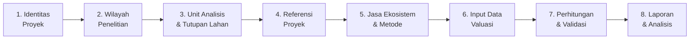
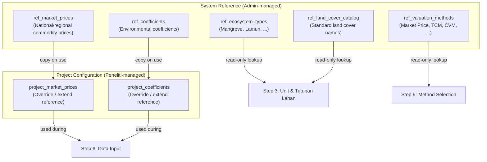
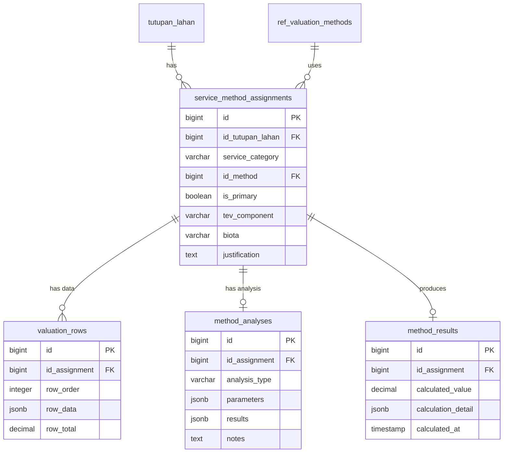
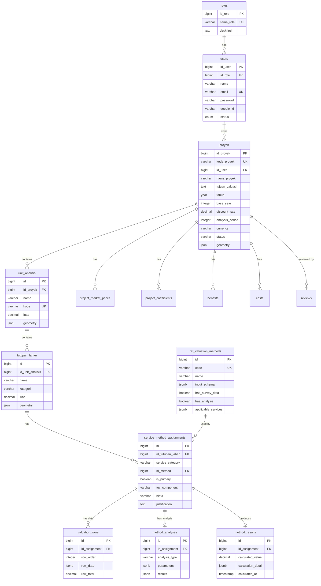
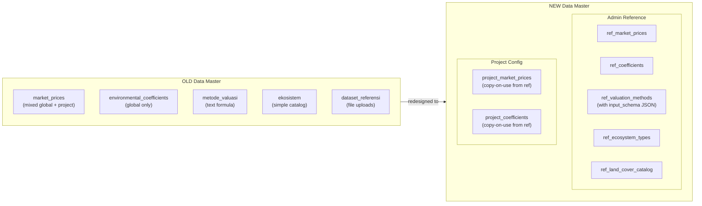

# Researcher Workflow Redesign — TEV Valuation System

## PKSPL IPB — Coastal & Marine Ecosystem Economic Valuation System

### Version 2.0 — Ground-Up Redesign

---

## Table of Contents

1. [Design Principles](#1-design-principles)
2. [Researcher Workflow — 8 Steps](#2-researcher-workflow--8-steps)
3. [Data Master Redesign](#3-data-master-redesign)
4. [Multi-Method Valuation Design](#4-multi-method-valuation-design)
5. [TEV Aggregation & Double-Counting Prevention](#5-tev-aggregation--double-counting-prevention)
6. [Data Model / ERD](#6-data-model--erd)
7. [Worked Example: TCM + CVM on Cultural Services](#7-worked-example-tcm--cvm-on-cultural-services)
8. [Validation Rules & Access Control](#8-validation-rules--access-control)
9. [Removed Components](#9-removed-components)
10. [Decisions Requiring Confirmation](#10-decisions-requiring-confirmation)
11. [Change Summary & Impact](#11-change-summary--impact)

---

## 1. Design Principles

These principles govern every design decision in this document.

| # | Principle | Implication |
|---|-----------|-------------|
| P1 | **One value, one TEV slot** | Each ecosystem service on each land cover contributes exactly one value to TEV. Multiple methods may estimate that value, but only the designated primary enters the sum. |
| P2 | **Reference ≠ Project data** | System-level reference catalogs (managed by Admin) are immutable snapshots when copied into a project. Changes to references never alter historical project data. |
| P3 | **Method-agnostic data layer** | The data storage layer does not hardcode columns per valuation method. Each method declares its input schema; the system validates and stores data accordingly. |
| P4 | **No AI dependencies** | All AI-related features, tables, endpoints, and UI components are removed. The system is deterministic and researcher-driven. |
| P5 | **Workflow ≠ enforcement** | Steps are a suggested sequence, not a locked gate. Researchers can navigate freely, but the system warns when prerequisites are incomplete. |
| P6 | **Auditability without AI** | All changes are tracked via activity logs and project history. Validation is human-driven (review workflow), not automated by AI. |

---

## 2. Researcher Workflow — 8 Steps

### 2.1 Workflow Overview



> [!NOTE]
> Steps are numbered for navigation, but researchers can move freely between steps. The system uses soft validation (warnings) rather than hard locks.

### 2.2 Step Details

---

#### Step 1 — Identitas Proyek (Project Identity)

**Purpose:** Create a new valuation project and define its economic parameters.

**Inputs:**
| Field | Type | Required | Description |
|-------|------|:--------:|-------------|
| `nama_proyek` | VARCHAR(150) | ✅ | Project name |
| `kode_proyek` | VARCHAR(50) | Auto | Auto-generated unique code (e.g., `PKS-A3X8K1`) |
| `tujuan_valuasi` | TEXT | ✅ | Valuation objective / research question |
| `tahun` | YEAR | ✅ | Research year |
| `deskripsi` | TEXT | ❌ | Free-form description |
| `base_year` | INTEGER | ✅ | Base year for economic calculations |
| `discount_rate` | DECIMAL(6,4) | ✅ | Discount rate for NPV (e.g., 0.0500 = 5%) |
| `analysis_period` | INTEGER | ✅ | Number of years for NPV analysis |
| `currency` | VARCHAR(10) | ✅ | Default `IDR` |

**What changed from old design:**
- Economic parameters (`discount_rate`, `base_year`, `analysis_period`) are now part of Step 1, not a separate `project_valuation_settings` entity disconnected from the project creation flow.
- The `status` field is retained for the review workflow (Draft → Submitted → Need Revision → Approved → Published).

**Output:** A `proyek` record with embedded economic configuration.

---

#### Step 2 — Wilayah Penelitian (Study Area)

**Purpose:** Define the spatial boundary of the research area.

**Inputs (choose one or combine):**
1. **Upload Shapefile** (.zip) → parsed client-side to GeoJSON → stored as `geometry`
2. **Administrative Boundary Picker** → select Provinsi → Kab/Kota → Kecamatan → Desa/Kelurahan → boundary polygon loaded from PostGIS
3. **Manual coordinates** → latitude, longitude, area

**Data stored on `proyek`:**
| Field | Description |
|-------|-------------|
| `id_provinsi`, `id_kabupaten_kota`, `id_kecamatan`, `id_desa_kelurahan` | Administrative location FKs |
| `latitude`, `longitude` | Center point |
| `luas`, `satuan_luas` | Total study area size and unit |
| `geometry` | GeoJSON polygon (project boundary) |
| `shapefile_files` | Uploaded shapefile metadata |

**No change from old design** — this step is well-designed.

---

#### Step 3 — Unit Analisis & Tutupan Lahan (Analysis Units & Land Cover)

**Purpose:** Subdivide the study area into analysis units, and classify land cover types within each unit.

**Hierarchy:**

```
Proyek (Study Area)
 └── Unit Analisis (Zone / Index)         ← e.g., "Zona Pesisir Utara"
      └── Tutupan Lahan (Land Cover)      ← e.g., "Mangrove Primer", "Lamun"
```

**What changed from old design:**
- **Renamed** from "Index" to "Unit Analisis" — clearer terminology.
- Each `unit_analisis` defines a sub-zone of the project area (name, code, area, optional geometry).
- Each `tutupan_lahan` is a land cover type within that unit (name, category, area, optional geometry).
- The `area_terdampak` + `ekosistem` legacy tables are **removed**. Their function is fully absorbed by `unit_analisis` + `tutupan_lahan` + the `ref_ecosystem_types` catalog.

**Relationship to old tables:**
| Old | New | Reason |
|-----|-----|--------|
| `indexes` | `unit_analisis` | Renamed for clarity |
| `jenis_tutupan_lahan` | `tutupan_lahan` | Shortened, same function |
| `area_terdampak` | Removed | Redundant with unit_analisis |
| `ekosistem` | `ref_ecosystem_types` | Moved to reference catalog |

**Key rule:** `tutupan_lahan` is the anchor entity for all valuation data downstream. Every piece of valuation data is scoped to a specific land cover.

---

#### Step 4 — Referensi Proyek (Project Reference Data)

**Purpose:** Configure project-specific economic reference data, inheriting from system defaults.

> [!IMPORTANT]
> This step replaces the old "Data Master" step. See [Section 3](#3-data-master-redesign) for the full redesign rationale.

**What the researcher does here:**

1. **Review inherited reference data** — system-level market prices and coefficients are shown as read-only defaults.
2. **Override or extend** — researcher can:
   - **Copy & modify** a system reference value for their project context
   - **Add new** project-specific market prices or coefficients not in the system catalog
3. **These overrides are frozen** — once used in valuation calculations, they become immutable project records. Subsequent system catalog changes do not affect them.

**Data categories available:**

| Category | System Reference (Admin) | Project Override (Peneliti) |
|----------|-------------------------|----------------------------|
| Market Prices | `ref_market_prices` | `project_market_prices` |
| Env. Coefficients | `ref_coefficients` | `project_coefficients` |
| Ecosystem Types | `ref_ecosystem_types` | Read-only reference |
| Valuation Methods | `ref_valuation_methods` | Read-only reference |

**Why this step is positioned here (after Step 3, before Step 5):**
- After defining land covers, the researcher knows which commodities and environmental parameters they'll need.
- Before selecting methods and entering data, reference prices and coefficients should be ready to use.

---

#### Step 5 — Jasa Ekosistem & Metode (Ecosystem Services & Methods)

**Purpose:** For each land cover, identify which ecosystem services are present and select valuation methods.

**This is the most significantly redesigned step.** Key changes:

##### 5a. Service Identification

For each `tutupan_lahan`, the researcher toggles which of the 4 service categories apply:

| Service Category | TEV Component (default) | Examples |
|-----------------|------------------------|---------|
| Provisioning (Penyediaan) | DUV | Fisheries, timber, non-timber products |
| Regulating (Pengaturan) | IUV | Carbon sequestration, coastal protection, water filtration |
| Supporting (Pendukung) | OV | Nutrient cycling, habitat provision, biodiversity |
| Cultural (Budaya) | EV | Tourism, recreation, aesthetic, spiritual value |

##### 5b. Method Selection — Multi-Method Support

For each **active service** on each **land cover**, the researcher selects **one or more** valuation methods:

```
Tutupan Lahan: "Hutan Mangrove"
 ├── Provisioning [Active]
 │    └── Method: Market Price (Primary ✓)
 ├── Regulating [Active]
 │    └── Method: Replacement Cost (Primary ✓)
 ├── Supporting [Inactive]
 └── Cultural [Active]
      ├── Method: TCM - Travel Cost Method (Primary ✓)
      └── Method: CVM - Contingent Valuation (Supporting)
```

**Critical rules:**
1. Each service on each land cover must have **exactly one primary method** that will be used for TEV aggregation.
2. Additional methods are marked as **supporting** — their results appear in the report for comparison/robustness but do **not** enter the TEV sum.
3. The researcher may also override the default TEV component mapping (e.g., assign cultural recreation to DUV instead of EV).

##### 5c. Biota Specification

For Provisioning services, the researcher optionally specifies biota type: **Flora** or **Fauna** (or both as separate method assignments).

**Data model:** See `service_method_assignments` in [Section 6](#6-data-model--erd).

---

#### Step 6 — Input Data Valuasi (Valuation Data Entry)

**Purpose:** Enter data for each method assignment created in Step 5.

**How it works:**

1. The UI renders a **dynamic form/spreadsheet** per method assignment.
2. Each method has an `input_schema` (defined in `ref_valuation_methods`) that specifies what fields are required.
3. The researcher enters one or more data rows per method assignment.
4. The researcher can also add **custom columns** beyond the method's standard schema.

**Method-specific input schemas (examples):**

| Method | Required Input Fields | Calculated Output |
|--------|----------------------|-------------------|
| **Market Price** | object_name, productivity, market_price, utilized_area, unit | `value = productivity × market_price × utilized_area` |
| **Replacement Cost** | cost_item, quantity, unit_cost | `value = Σ(quantity × unit_cost)` |
| **Effect on Production** | commodity, qty_before, qty_after, output_price, production_cost | `value = (qty_after - qty_before) × output_price - production_cost` |
| **Travel Cost (TCM)** | respondent_id, distance, travel_cost, annual_visits, time_cost, socioeconomic_data | Regression → consumer_surplus_per_visit × total_visits |
| **Contingent Valuation (CVM)** | respondent_id, elicitation_format, bid_amount, wtp_response, wtp_amount, socioeconomic_data | Statistical analysis → mean_WTP × population |
| **Hedonic Price (HPM)** | property_id, transaction_price, env_quality, lot_size, rooms, characteristics | Regression → marginal implicit price of env. attribute |
| **Benefit Transfer** | source_study, source_value, adjustment_factor | `value = source_value × adjustment_factor` |

**Data storage:** All data rows are stored in `valuation_rows` with a flexible `row_data` JSON column. The system validates `row_data` against the method's `input_schema` at the application layer.

**TCM and CVM specifics:**
- These methods require **survey data** (many respondent rows) plus **statistical analysis** (regression, WTP estimation).
- The survey data is stored as valuation rows (one row per respondent).
- The analysis results (regression coefficients, consumer surplus, mean WTP, etc.) are stored in a separate `method_analyses` table linked to the method assignment.

**Autosave:** Data is auto-saved with a visual indicator. No explicit "save" button needed.

---

#### Step 7 — Perhitungan & Validasi (Calculation & Validation)

**Purpose:** Calculate TEV, BCR, NPV and validate results for consistency.

**Calculations performed:**

##### 7a. Per-Method Results

For each method assignment, the system calculates a `result_value`:
- **Simple methods** (Market Price, Replacement Cost, Benefit Transfer): Sum of row totals
- **Survey methods** (TCM, CVM, HPM): Statistical analysis output from `method_analyses`

##### 7b. TEV Aggregation

```
For each tutupan_lahan:
  For each active service_category:
    tev_component_value = result_value of PRIMARY method assignment

TEV(tutupan_lahan) = Σ tev_component_values across all services

TEV(project) = Σ TEV(tutupan_lahan) across all land covers
```

TEV decomposition:
```
TEV = Use Value + Non-Use Value
    = (DUV + IUV + OV) + (EV + BV)
```

##### 7c. BCR & NPV (if applicable)

```
BCR = Σ PV(Benefits) ÷ Σ PV(Costs)
NPV = Σ [ (Benefits_t - Costs_t) / (1 + r)^t ]  for t = 0..analysis_period
```

Benefits and costs are manually entered by the researcher in dedicated tables, linked to the project.

##### 7d. Validation Checks

The system performs automated consistency checks:

| Check | Severity | Description |
|-------|----------|-------------|
| Missing primary method | 🔴 Error | A service is active but has no primary method |
| No data rows | 🟡 Warning | A method assignment has no data entered |
| Zero result value | 🟡 Warning | A primary method calculated to zero |
| TEV component unassigned | 🔴 Error | A primary method has no TEV component mapping |
| Multiple primaries | 🔴 Error | More than one primary method for same service + land cover |
| Analysis missing | 🟡 Warning | TCM/CVM has survey data but no analysis result |
| Negative NPV | 🟢 Info | NPV is negative (costs exceed benefits) |

---

#### Step 8 — Laporan & Analisis (Report & Analysis)

**Purpose:** Visualize results, generate reports, submit for review.

**Sub-features:**

1. **Analytics Dashboard** — Charts (Recharts) showing:
   - TEV composition per land cover (stacked bar)
   - TEV by service category (pie chart)
   - Multi-method comparison (grouped bar showing primary vs supporting method results)
   - Benefits vs Costs over time (line chart, if BCR/NPV used)

2. **Report Preview** — Comprehensive report including:
   - Project metadata and study area map
   - Methodology summary (which methods used where, and why)
   - Data tables per land cover per service
   - TEV calculation breakdown
   - Multi-method comparison table (all method results, primary clearly marked)
   - BCR / NPV results (if applicable)
   - References and data sources

3. **PDF Export** — Generate printable report via jsPDF + html2canvas

4. **Submit for Review** — Submit project for analyst/admin review
   - Creates `review` record
   - Status changes: Draft → Submitted
   - Reviewer can comment, request revision, approve, or reject

---

## 3. Data Master Redesign

### 3.1 Problem with the Old Design

The old "Data Master" step conflated three different concerns:

| Concern | Old Approach | Problem |
|---------|-------------|---------|
| **System reference data** | Admin manages `ekosistem`, `metode_valuasi` globally; `market_prices` and `environmental_coefficients` are mixed global/project | No clear separation. Changing a global market price could affect interpretation of historical projects. |
| **Project-specific overrides** | `market_prices` with `id_proyek=NULL` means global, non-NULL means project | Ambiguous. Hard to tell what's a reference vs what's project-specific. |
| **Method catalogs** | `metode_valuasi` table with formula/parameter text | Formulas stored as text are not machine-executable. No input schema definition. |

### 3.2 Redesigned Data Master Architecture



### 3.3 Reference Tables (Admin-Managed)

#### `ref_ecosystem_types`
Replaces old `ekosistem` table. A catalog of ecosystem types used when creating land covers.

| Column | Type | Description |
|--------|------|-------------|
| `id` | BIGINT PK | |
| `name` | VARCHAR(150) | e.g., "Mangrove", "Terumbu Karang", "Lamun", "Pantai Berpasir" |
| `description` | TEXT | |
| `is_active` | BOOLEAN | Admin can deactivate without deleting |

#### `ref_valuation_methods`
Replaces old `metode_valuasi`. Enriched with machine-readable `input_schema`.

| Column | Type | Description |
|--------|------|-------------|
| `id` | BIGINT PK | |
| `code` | VARCHAR(50) UNIQUE | Slug: `market-price`, `tcm`, `cvm`, `replacement-cost`, `eop`, `hpm`, `abm`, `benefit-transfer` |
| `name` | VARCHAR(150) | Display name |
| `description` | TEXT | Method description |
| `input_schema` | JSONB | Defines required/optional fields for data rows. Used for dynamic form rendering and validation. |
| `has_survey_data` | BOOLEAN | `true` for TCM, CVM, HPM, CE — methods that require per-respondent survey data |
| `has_analysis` | BOOLEAN | `true` if method requires a separate statistical analysis step |
| `applicable_services` | JSONB | Array of service categories this method can be used with, e.g., `["provisioning", "cultural"]` |
| `default_tev_component` | VARCHAR(10) | Default TEV component, e.g., `DUV` |
| `is_active` | BOOLEAN | |

**Example `input_schema` for Market Price method:**
```json
{
  "fields": [
    { "key": "object_name", "label": "Nama Objek", "type": "text", "required": true },
    { "key": "latin_name", "label": "Nama Latin", "type": "text", "required": false },
    { "key": "local_name", "label": "Nama Daerah", "type": "text", "required": false },
    { "key": "productivity", "label": "Produktivitas", "type": "decimal", "required": true, "unit_field": "productivity_unit" },
    { "key": "market_price", "label": "Harga Pasar (Rp)", "type": "decimal", "required": true },
    { "key": "utilized_area", "label": "Luas Pemanfaatan", "type": "decimal", "required": true, "unit_field": "area_unit" },
    { "key": "reference", "label": "Referensi", "type": "text", "required": false }
  ],
  "formula": "productivity * market_price * utilized_area",
  "result_field": "total_value"
}
```

#### `ref_market_prices`
National/regional commodity price catalog.

| Column | Type | Description |
|--------|------|-------------|
| `id` | BIGINT PK | |
| `commodity_name` | VARCHAR(150) | |
| `unit` | VARCHAR(50) | e.g., "kg", "ton", "ekor" |
| `price` | DECIMAL(20,2) | |
| `year` | INTEGER | Price year |
| `region` | VARCHAR(150) | Region scope (national, province name, etc.) |
| `source` | VARCHAR(200) | Data source (BPS, research publication, etc.) |
| `is_active` | BOOLEAN | |

#### `ref_coefficients`
Standard environmental coefficients catalog.

| Column | Type | Description |
|--------|------|-------------|
| `id` | BIGINT PK | |
| `category` | VARCHAR(100) | e.g., "carbon_sequestration", "nutrient_cycling" |
| `parameter` | VARCHAR(150) | e.g., "carbon_absorption_rate" |
| `value` | DECIMAL(15,6) | |
| `unit` | VARCHAR(50) | |
| `source` | VARCHAR(200) | |
| `is_active` | BOOLEAN | |

#### `ref_land_cover_catalog`
Standard land cover type names. New table — helps ensure consistent naming across projects.

| Column | Type | Description |
|--------|------|-------------|
| `id` | BIGINT PK | |
| `name` | VARCHAR(150) | e.g., "Mangrove Primer", "Mangrove Sekunder", "Padang Lamun" |
| `ecosystem_type_id` | FK → ref_ecosystem_types | Parent ecosystem |
| `description` | TEXT | |
| `is_active` | BOOLEAN | |

### 3.4 Project-Specific Tables (Peneliti-Managed)

#### `project_market_prices`
| Column | Type | Description |
|--------|------|-------------|
| `id` | BIGINT PK | |
| `id_proyek` | FK → proyek | Project scope |
| `ref_price_id` | FK → ref_market_prices, NULLABLE | Source reference (NULL = custom entry) |
| `commodity_name` | VARCHAR(150) | Copied or custom |
| `unit` | VARCHAR(50) | |
| `price` | DECIMAL(20,2) | |
| `year` | INTEGER | |
| `source` | VARCHAR(200) | |

#### `project_coefficients`
| Column | Type | Description |
|--------|------|-------------|
| `id` | BIGINT PK | |
| `id_proyek` | FK → proyek | Project scope |
| `ref_coefficient_id` | FK → ref_coefficients, NULLABLE | Source reference (NULL = custom) |
| `category` | VARCHAR(100) | |
| `parameter` | VARCHAR(150) | |
| `value` | DECIMAL(15,6) | |
| `unit` | VARCHAR(50) | |
| `source` | VARCHAR(200) | |

### 3.5 Immutability Rule

> [!WARNING]
> When a researcher copies a reference value into their project, that copy is **frozen**. If an admin later updates the system reference catalog, existing project copies are **not** affected. This ensures historical research data integrity.

The `ref_price_id` / `ref_coefficient_id` FK serves as a provenance link ("this project value was originally derived from system reference #42") but the actual values used are always read from the `project_*` table.

---

## 4. Multi-Method Valuation Design

### 4.1 Core Concept

In environmental economics, researchers often apply multiple valuation methods to the same ecosystem service to increase confidence in their estimates. The system must:

1. **Allow** N methods per service per land cover
2. **Require** exactly 1 primary method per service per land cover
3. **Store** results from all methods
4. **Aggregate** only primary results into TEV

### 4.2 Data Model



### 4.3 The `service_method_assignments` Table

This is the **central linking table** that replaces the old `area_service_configs`:

| Column | Type | Constraints | Description |
|--------|------|-------------|-------------|
| `id` | BIGINT | PK | |
| `id_tutupan_lahan` | BIGINT | FK → tutupan_lahan, CASCADE DELETE | Land cover |
| `service_category` | VARCHAR(20) | NOT NULL | `provisioning`, `regulating`, `supporting`, `cultural` |
| `id_method` | BIGINT | FK → ref_valuation_methods | Selected method |
| `is_primary` | BOOLEAN | NOT NULL, DEFAULT true | Is this the primary method for TEV aggregation? |
| `tev_component` | VARCHAR(5) | NOT NULL | `DUV`, `IUV`, `OV`, `EV`, `BV` |
| `biota` | VARCHAR(20) | NULLABLE | `flora`, `fauna` — for provisioning |
| `justification` | TEXT | NULLABLE | Why this method was chosen (for report) |
| | | **UNIQUE** | (`id_tutupan_lahan`, `service_category`, `id_method`) |

**Application-level constraint:** For each `(id_tutupan_lahan, service_category)`, exactly one assignment must have `is_primary = true`.

### 4.4 Old vs New Comparison

| Aspect | Old Design (`area_service_configs`) | New Design (`service_method_assignments`) |
|--------|-------------------------------------|-------------------------------------------|
| Methods per service | 1 (UNIQUE on land_cover + service) | N (UNIQUE on land_cover + service + method) |
| Primary designation | N/A (only one method possible) | `is_primary` boolean |
| TEV component | Hardcoded per service category | Configurable `tev_component` per assignment |
| Method justification | Not stored | `justification` field for report |
| Biota | On the config row | Retained on the assignment row |

---

## 5. TEV Aggregation & Double-Counting Prevention

### 5.1 Aggregation Algorithm

```
TEV(project) = 0

for each tutupan_lahan in project:
    for each service_category in [provisioning, regulating, supporting, cultural]:
        assignments = get_assignments(tutupan_lahan, service_category)
        if assignments is empty:
            continue

        primary = assignments.where(is_primary = true)
        assert primary.count() == 1  ← enforced by system

        result = method_results.where(id_assignment = primary.id)
        if result exists:
            TEV(project) += result.calculated_value
```

### 5.2 Double-Counting Prevention Rules

| Rule | Enforcement | Level |
|------|-------------|-------|
| Only primary method enters TEV | Application logic + query filter | Automatic |
| One primary per service per land cover | DB check + UI validation | Automatic |
| Supporting method results shown separately | Report template | Automatic |
| Same TEV component not counted twice from different services | 🟡 Warning only | Semi-automatic |
| Researcher must justify method choice | `justification` field | Manual |

> [!IMPORTANT]
> **Rule on TEV component overlap:** If two services on the same land cover both map to `DUV` (e.g., provisioning=DUV and cultural_recreation=DUV), the system emits a **warning** but does not block it. The researcher must justify this in the report. Some legitimate cases exist (e.g., provisioning fish harvest is different from recreational fishing).

### 5.3 What the Report Shows

```
┌──────────────────────────────────────────────────────────────┐
│ Tutupan Lahan: Hutan Mangrove (50 ha)                        │
├──────────────────┬────────────┬──────────────┬───────────────┤
│ Jasa Ekosistem   │ Metode     │ Nilai (Rp)   │ Status        │
├──────────────────┼────────────┼──────────────┼───────────────┤
│ Provisioning     │ Market Price│ 1,200,000,000│ ★ Primary→DUV│
│ Regulating       │ Repl. Cost │   800,000,000│ ★ Primary→IUV│
│ Cultural         │ TCM        │   500,000,000│ ★ Primary→EV │
│ Cultural         │ CVM        │   350,000,000│ ○ Supporting  │
├──────────────────┴────────────┼──────────────┼───────────────┤
│ TEV (primary only)            │ 2,500,000,000│               │
│ CVM comparison                │   350,000,000│ (-30% vs TCM) │
└───────────────────────────────┴──────────────┴───────────────┘
```

---

## 6. Data Model / ERD

### 6.1 Complete ERD — Core + Valuation



### 6.2 Tables Removed

| Old Table | Reason for Removal |
|-----------|--------------------|
| `analisis_ai` | AI removed (P4) |
| `basis_data_ai` | AI removed (P4) |
| `ai_history` | AI removed (P4) |
| `area_terdampak` | Redundant with `unit_analisis` |
| `ekosistem` | Replaced by `ref_ecosystem_types` |
| `metode_valuasi` | Replaced by `ref_valuation_methods` (with input_schema) |
| `market_prices` | Split into `ref_market_prices` + `project_market_prices` |
| `environmental_coefficients` | Split into `ref_coefficients` + `project_coefficients` |
| `provisioning_service` | Consolidated into `valuation_rows` + method schema |
| `regulating_service` | Consolidated into `valuation_rows` + method schema |
| `supporting_service` | Consolidated into `valuation_rows` + method schema |
| `cultural_service` | Consolidated into `valuation_rows` + method schema |
| `area_service_configs` | Replaced by `service_method_assignments` |
| `valuation_modules` | Replaced by `service_method_assignments` + `method_analyses` |
| `hasil_valuasi` | Replaced by `method_results` |
| `dataset_referensi` | Scope unclear — see [Decision #9](#10-decisions-requiring-confirmation) |
| `eop_data`, `tcm_data`, `cvm_data`, `duv_data`, `hpm_data`, `abm_data`, `ce_data` | Consolidated into `valuation_rows` with flexible `row_data` |
| `tcm_analyses`, `cvm_analyses` | Consolidated into `method_analyses` |
| `index_ekosistem_summary`, `valuasi_*` reference tables | Replaced by `ref_*` catalog pattern |

### 6.3 Tables Retained (Unchanged or Minor Changes)

| Table | Status |
|-------|--------|
| `roles`, `users` | Retained |
| `proyek` | Retained + absorbs `project_valuation_settings` |
| `provinsi`, `kabupaten_kota`, `kecamatan`, `desa_kelurahan` | Retained |
| `administrative_boundaries` | Retained |
| `reviews`, `review_comments`, `comment_mentions`, `comment_attachments`, `comment_edit_histories` | Retained |
| `conversations`, `conversation_participants`, `messages`, `message_attachments`, `notification_preferences` | Retained |
| `activity_logs`, `histori` | Retained |
| `benefits`, `costs` | Retained |
| `valuation_custom_columns` | Retained, FK changes to `id_assignment` |

---

## 7. Worked Example: TCM + CVM on Cultural Services

### Scenario

**Project:** Valuasi Ekonomi Ekosistem Taman Nasional Kepulauan Seribu
**Land Cover:** Terumbu Karang (Coral Reef), 120 ha
**Service:** Cultural Services (recreation/tourism)
**Methods:** TCM (primary) + CVM (supporting)

### Step 5 — Method Assignment

| Assignment | Service | Method | Primary | TEV Component |
|------------|---------|--------|:-------:|:-------------:|
| #1 | Cultural | TCM | ✅ Yes | EV |
| #2 | Cultural | CVM | ❌ No | — (supporting) |

### Step 6 — Data Entry

#### TCM Survey Data (`valuation_rows` for Assignment #1)

Each row represents one survey respondent:

| row_order | row_data (JSON) |
|:---------:|----------------|
| 1 | `{"respondent_id": "R001", "origin": "Jakarta", "distance_km": 150, "travel_cost": 450000, "annual_visits": 3, "time_cost": 200000, "income": 8000000}` |
| 2 | `{"respondent_id": "R002", "origin": "Bogor", "distance_km": 180, "travel_cost": 520000, "annual_visits": 2, "time_cost": 250000, "income": 6500000}` |
| ... | ... (100+ respondents) |

#### CVM Survey Data (`valuation_rows` for Assignment #2)

| row_order | row_data (JSON) |
|:---------:|----------------|
| 1 | `{"respondent_id": "R001", "elicitation": "dichotomous_choice", "bid_amount": 50000, "wtp_response": true, "stated_wtp": 75000, "income": 8000000}` |
| 2 | `{"respondent_id": "R002", "elicitation": "dichotomous_choice", "bid_amount": 50000, "wtp_response": false, "stated_wtp": 30000, "income": 6500000}` |
| ... | ... (100+ respondents) |

### Step 6 (continued) — Statistical Analysis

#### TCM Analysis (`method_analyses` for Assignment #1)

```json
{
  "analysis_type": "zonal_tcm",
  "parameters": {
    "model_type": "poisson_regression",
    "dependent_variable": "visits_per_1000_population",
    "independent_variables": ["travel_cost", "income", "substitute_sites"]
  },
  "results": {
    "coefficients": {
      "intercept": 4.521,
      "travel_cost": -0.00032,
      "income": 0.00015,
      "substitute_sites": -0.287
    },
    "r_squared": 0.72,
    "n": 112,
    "consumer_surplus_per_visit": 156250,
    "total_annual_visits": 45000,
    "total_recreation_value": 7031250000
  }
}
```

**Result:** Cultural Value (TCM) = **Rp 7,031,250,000** /year

#### CVM Analysis (`method_analyses` for Assignment #2)

```json
{
  "analysis_type": "dichotomous_choice_logit",
  "parameters": {
    "model_type": "logistic_regression",
    "dependent_variable": "wtp_response",
    "independent_variables": ["bid_amount", "income", "education", "visit_frequency"]
  },
  "results": {
    "coefficients": {
      "intercept": 2.15,
      "bid_amount": -0.000028,
      "income": 0.00012,
      "education": 0.35
    },
    "mean_wtp": 48500,
    "median_wtp": 42000,
    "population": 85000,
    "total_wtp": 4122500000,
    "n": 108,
    "protest_rate": 0.08
  }
}
```

**Result:** Cultural Value (CVM) = **Rp 4,122,500,000** /year

### Step 7 — TEV Aggregation

| Service | Method | Value (Rp) | Status | Enters TEV? |
|---------|--------|-----------|--------|:-----------:|
| Cultural | TCM | 7,031,250,000 | ★ Primary | ✅ Yes |
| Cultural | CVM | 4,122,500,000 | ○ Supporting | ❌ No |

**TEV contribution from Cultural Services: Rp 7,031,250,000** (from TCM only)

**Report note:** CVM estimate (Rp 4.12B) is 41% lower than TCM (Rp 7.03B). This divergence is expected — CVM measures stated preferences (hypothetical WTP) while TCM captures revealed preferences (actual expenditure). The TCM estimate is preferred as the primary value because it is based on observed behavior.

---

## 8. Validation Rules & Access Control

### 8.1 Data Validation Rules

| Entity | Rule | Enforcement |
|--------|------|-------------|
| `proyek` | `discount_rate` must be 0–1 | Form Request |
| `proyek` | `base_year` ≤ `tahun` | Form Request |
| `unit_analisis` | `kode` unique within project | DB UNIQUE + validation |
| `tutupan_lahan` | `luas` > 0 | Form Request |
| `service_method_assignments` | Exactly 1 primary per (tutupan_lahan, service_category) | Application logic + UI |
| `service_method_assignments` | `id_method` must be in `applicable_services` for the chosen `service_category` | Application logic |
| `valuation_rows.row_data` | Must conform to method's `input_schema` | Application-layer JSON schema validation |
| `method_results` | Cannot be manually edited — computed only | Controller logic |
| `benefits` / `costs` | `value` > 0 | Form Request |

### 8.2 Access Control Matrix

| Action | Super Admin | Analis | Peneliti | Guest |
|--------|:-----------:|:------:|:--------:|:-----:|
| CRUD ref_* catalog | ✅ | ❌ | ❌ | ❌ |
| CRUD users | ✅ | ❌ | ❌ | ❌ |
| Create own project | ✅ | ❌ | ✅ | ❌ |
| Edit own project data | ✅ | ❌ | ✅ (owner only) | ❌ |
| View all projects | ✅ | ✅ (assigned) | ❌ (own only) | ❌ |
| Review & decide | ✅ | ✅ | ❌ | ❌ |
| Comment on review | ✅ | ✅ | ✅ (own project) | ❌ |
| View published results | ✅ | ✅ | ✅ | ✅ |
| Chat/messaging | ✅ | ✅ | ✅ | ❌ |
| View activity logs | ✅ | ❌ | ❌ | ❌ |

---

## 9. Removed Components

### 9.1 AI — Complete Removal

| Removed Table | Original Purpose |
|---------------|-----------------|
| `analisis_ai` | AI Q&A per project |
| `basis_data_ai` | Knowledge base for AI |
| `ai_history` | AI interaction history |

| Removed Controller | Original Purpose |
|--------------------|-----------------|
| `AIController` | AI endpoint |
| `AnalisisAiController` | AI analysis CRUD |
| `BasisDataAiController` | AI knowledge base CRUD |

| Removed Routes | |
|----------------|--|
| `POST /ai/generate` | AI text generation |
| `POST /ai/health` | AI health check |
| `GET/POST /ai/test` | AI test endpoint |
| CRUD `/analisis-ai` | AI analysis CRUD |
| CRUD `/basis-data-ai` | AI knowledge base CRUD |

| Removed Frontend | |
|-----------------|--|
| `AIContent.jsx` | AI dashboard component |

### 9.2 Legacy Valuation Tables — Consolidated

The 4 fixed-column service tables (`provisioning_service`, `regulating_service`, `supporting_service`, `cultural_service`) and 9 method-specific data tables (`eop_data`, `tcm_data`, `cvm_data`, etc.) are **all consolidated** into the flexible `valuation_rows` + `method_analyses` pattern.

**Rationale:** Having 13+ separate tables with hardcoded columns for each method creates rigidity. Adding a new method requires a new migration. The flexible `row_data` JSON approach with `input_schema` validation achieves the same data integrity while allowing methods to be added purely through configuration.

---

## 10. Decisions Requiring Confirmation

The following design decisions are based on assumptions that need stakeholder input:

| # | Decision | Current Assumption | Alternatives | Impact |
|---|----------|--------------------|-------------|--------|
| 1 | **TEV component mapping** | Researcher can override the default TEV component per method assignment | Lock to service-level defaults (Provisioning=DUV, Regulating=IUV, etc.) | Affects TEV calculation flexibility |
| 2 | **Supporting method results** | Shown in report only, never enter TEV | Allow weighted average of multiple methods | Changes aggregation algorithm |
| 3 | **Survey data storage** | All respondent data stored in `valuation_rows` as JSON | Separate structured tables per survey method (tcm_respondents, cvm_respondents) | Affects query performance for large surveys |
| 4 | **Statistical analysis** | Researcher enters analysis results manually (coefficients, WTP, etc.) | System performs regression/analysis automatically | Major implementation scope change |
| 5 | **Benefit Transfer method** | Included as a method option | Exclude — not primary research | Affects method catalog |
| 6 | **Biota separation** | Biota (flora/fauna) is a property of the method assignment | Biota creates separate sub-rows within the same assignment | Affects data entry UX |
| 7 | **BCR/NPV** | Optional — researcher can skip if not applicable | Required for all projects | Affects workflow completeness validation |
| 8 | **ref_land_cover_catalog** | New table — standardized land cover names | Let researchers free-type land cover names (no catalog) | Affects data consistency across projects |
| 9 | **dataset_referensi** | Keep or remove? Currently used for uploading reference files | Convert to a file attachment feature on the project level | Affects admin features |
| 10 | **Custom columns on valuation_rows** | Retained — researchers can add custom fields beyond input_schema | Remove — force all data through input_schema only | Affects flexibility vs consistency |
| 11 | **Who can be Analis reviewer?** | Separate role with review-only access | Super Admin performs review (no separate Analis role) | Affects RBAC design |
| 12 | **Project status workflow** | Draft → Submitted → Need Revision → Approved → Published | Simpler: Draft → Published (no review gate) | Affects review feature scope |

---

## 11. Change Summary & Impact

### 11.1 Major Changes

| # | Change | Reason | Impact |
|---|--------|--------|--------|
| **C1** | **Multi-method support** via `service_method_assignments` with `is_primary` flag | Old design forced 1 method per service. Real research often uses 2+ methods for robustness. | New table, new UI for method selection, primary designation, comparison reporting |
| **C2** | **Data Master split** into `ref_*` (admin) + `project_*` (peneliti) with copy-on-use immutability | Old design mixed global and project data in same tables. Admin changes could corrupt historical projects. | 6 new tables replacing 3 old ones. Clear ownership boundaries. |
| **C3** | **Consolidated valuation data** — 13 rigid tables → 1 flexible `valuation_rows` table with JSON `row_data` validated against method `input_schema` | Each method had its own hardcoded table. Adding a method required a migration. | Massive schema simplification. Methods become configuration, not code. |
| **C4** | **AI complete removal** — 3 tables, 3 controllers, all routes and UI | AI features were not core to valuation research. Adds complexity without clear value. | Simpler codebase. Removes AI dependencies. |
| **C5** | **Renamed "Index" → "Unit Analisis"** and removed `area_terdampak` + `ekosistem` legacy tables | "Index" was confusing. `area_terdampak` was redundant with the index/land-cover hierarchy. | Cleaner conceptual model. |
| **C6** | **Economic params moved to project** — `project_valuation_settings` absorbed into `proyek` table | Separate settings table was disconnected from project creation. | Simpler schema. Params set during project creation. |
| **C7** | **Method input_schema on ref_valuation_methods** — machine-readable JSON defining what fields each method needs | Old `formula` and `parameter` text fields were not executable. | Enables dynamic form rendering, automated validation, and future method additions without code changes. |
| **C8** | **Double-counting prevention** — enforced primary-only TEV aggregation with warnings for TEV component overlap | Old design had no mechanism to prevent summing incompatible method results. | New validation logic. Report clearly distinguishes primary vs supporting. |
| **C9** | **Workflow reduced from 9 to 8 steps** — merged old "Index" and "Tutupan Lahan" into one step; merged "Analytics" into "Report" | Old steps were artificially split. Some had very little content on their own. | Streamlined researcher experience. |

### 11.2 Impact on Implementation Layers

| Layer | Impact |
|-------|--------|
| **Database** | ~15 tables removed/consolidated, ~8 new tables, several tables modified. Net reduction in table count. Migration plan needed. |
| **Backend (Laravel)** | Remove AI controllers/models/routes. Refactor valuation controllers to use `service_method_assignments` + `valuation_rows`. Add JSON schema validation against `input_schema`. Update seeders for new `ref_*` tables. |
| **Frontend (React)** | Redesign Step 5 UI for multi-method selection with primary toggle. Redesign Step 6 for dynamic forms driven by `input_schema`. Add multi-method comparison charts. Remove AI components. Update sidebar from 9 to 8 steps. |
| **API** | New endpoints for `service_method_assignments`, `method_analyses`, `method_results`. Refactor valuation data endpoints. Remove AI endpoints. Split master data endpoints into ref vs project. |
| **Reports** | Report template must show all method results with clear primary/supporting distinction. Multi-method comparison table is new. |

### 11.3 Data Master — Before vs After



### 11.4 Key Risks

| Risk | Mitigation |
|------|-----------|
| JSON `row_data` loses queryability vs typed columns | Add computed/indexed columns for frequently queried fields. Use JSONB with GIN indexes in PostgreSQL. |
| `input_schema` becomes complex to maintain | Provide an admin UI for schema editing with preview. Version schemas. |
| Multi-method UX complexity for researchers | Default to single-method (auto-primary). Multi-method is opt-in. |
| Migration from old schema to new | Write a one-time data migration script that maps old fixed-column rows to new JSON format. |

---

*This document is a standalone specification written from first principles. It assumes no existing implementation and evaluates all structures on their merits. Assumptions marked in Section 10 require stakeholder confirmation before implementation begins.*
